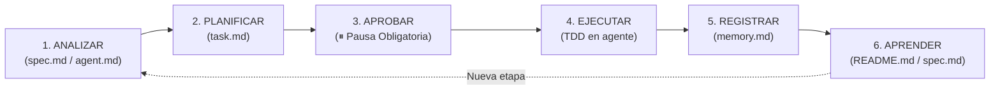

# HARNESS Governance Framework — Lecciones Aprendidas FOBANDOR

## El Ciclo HARNESS



---

## Fase 1: ANALIZAR

**Propósito:** Comprender el problema, los requisitos y las restricciones antes de proponer soluciones.

**Artefactos:**
- `spec.md`: Especificación técnica detallada con diagramas de arquitectura.
- `agent.md`: Reglas de comportamiento del agente, tecnologías y restricciones.
- `memory.md`: Bitácora de ADRs, hallazgos y decisiones acumuladas.

**Regla:** Nunca saltar a "Planificar" sin haber leído los ADRs existentes en `memory.md`.

---

## Fase 2: PLANIFICAR

**Propósito:** Descomponer el trabajo en tareas atómicas, verificables e independientes.

**Artefactos:** `task.md` — Registro de tareas con estado por etapa.

**Formato de tarea atómica:**
```markdown
### Tarea X.Y: Descripción clara y accionable

- [ ] **Contexto:** Por qué existe esta tarea.
- [ ] **Acción 1:** Paso atómico y verificable.
- [ ] **Acción 2:** ...
- [ ] **Verificación de Aceptación:** Cómo saber que está completo.
```

**Principio:** Una tarea atómica debe poder ejecutarse en 1 sesión de trabajo y tener un criterio de aceptación observable (test que pasa, URL que responde, correo recibido).

---

## Fase 3: APROBAR (Pausa Obligatoria)

> [!IMPORTANT]
> **Regla Inmutable:** Ningún cambio de código, configuración ni infraestructura
> puede ejecutarse sin aprobación explícita del Desarrollador Líder.
> Esto incluye hotfixes de producción.

**El agente debe:**
1. Presentar el plan completo.
2. Esperar confirmación explícita ("aprobado", "procede", "ejecuta").
3. Nunca interpretar el silencio como aprobación.

**Lección aprendida (Incidente Post-Despliegue Etapa 4):**
> Durante la atención del incidente 502 en vivo, el agente implementó cambios directamente
> sin registrar la tarea en `task.md` ni solicitar aprobación previa. El incidente fue
> regularizado incorporando la **Tarea 4.6** retroactivamente.
>
> **Medida correctiva:** Incluso en incidentes de producción, formular la tarea atómica
> antes de ejecutar cualquier fix.

---

## Fase 4: EJECUTAR

**Principios de ejecución:**
- **TDD**: Escribir el test antes que el código de producción.
- **Un commit por tarea**: Semántico (`feat:`, `fix:`, `docs:`, `chore:`).
- **Flake8 limpio**: `flake8 config fobandor scripts` sin errores antes de cada commit.
- **Suite completa**: `pytest` pasando al 100% antes de cada `git push`.

**Checklist previo al commit:**
```bash
pytest                                    # 100% passing
flake8 config fobandor scripts            # 0 errores
python manage.py check                    # 0 issues
python manage.py makemigrations --check   # Sin cambios pendientes
git commit -m "feat(billing): descripción concisa del cambio"
```

---

## Fase 5: REGISTRAR

**Propósito:** Preservar el conocimiento adquirido para futuras sesiones.

**Artefactos:**
- `memory.md`: ADRs, incidentes, hallazgos y decisiones técnicas.
- `task.md`: Estado final de tareas completadas.

**Formato ADR (Architecture Decision Record):**
```markdown
### [ADR-XXX] Título de la Decisión

* **Estado:** Aprobado / Propuesto / Deprecado.
* **Contexto:** Por qué fue necesario tomar esta decisión.
* **Decisión:** Qué se decidió hacer.
* **Justificación:** Por qué esta opción sobre las alternativas.
* **Consecuencias:** Impacto técnico, deuda o beneficios.
```

---

## Fase 6: APRENDER

**Propósito:** Actualizar la documentación pública y las skills para que el conocimiento persista.

**Artefactos:**
- `README.md`: Documentación para desarrolladores.
- `spec.md`: Especificación técnica actualizada.
- `skills/`: Skills con lecciones aprendidas (este archivo).

---

## Gestión de Hallazgos QA

**Principio de Desacoplamiento:** Cuando se detectan múltiples hallazgos QA de distinta naturaleza (UX vs. Infraestructura), crear etapas independientes.

**Lección aprendida (Etapas 6 y 7):**
> Los 3 hallazgos de QA fueron desacoplados en:
> - **Etapa 6 (Inmediata):** Mejoras frontend de UX (contraste, selector de planes). Riesgo bajo, impacto visual.
> - **Etapa 7 (Posterior):** Infraestructura SMTP. Riesgo medio, requiere configuración de servidor.
>
> Mezclar ambos en una sola etapa habría retrasado las mejoras visuales de bajo riesgo.

---

## Documentación de Incidentes en Producción

**Formato estándar para memory.md:**
```markdown
## XX. Incidente: [Nombre descriptivo]

### Síntoma
¿Qué vio el usuario/equipo?

### Causa Raíz
¿Por qué ocurrió técnicamente?

### Solución
¿Qué se cambió exactamente?

### Lección Aprendida
¿Qué regla o patrón se debe aplicar en el futuro?

### Verificación
¿Cómo se confirmó que el fix funcionó?
```

---

## Gestión de Versiones y Releases

```bash
# Estrategia trunk-based: 1 rama = main
git checkout main

# Commits semánticos
git commit -m "feat(billing): add invoice PDF link to customer email"
git commit -m "fix(webhook): handle StripeObject in invoice lines extraction"
git commit -m "docs: update spec.md with Formspree integration"

# Release estable
git tag v1.0.0 -m "Release: MVP completo con Stripe, SLA y notificaciones"
git push origin v1.0.0
```

---

## Archivos de Gobernanza del Proyecto

| Archivo | Propósito |
|:---|:---|
| `spec.md` | Especificación técnica viva: arquitectura, modelos, diagramas |
| `task.md` | Registro cronológico de tareas por etapa con estado |
| `memory.md` | Bitácora de ADRs, decisiones, incidentes y lecciones |
| `README.md` | Documentación pública para desarrolladores y onboarding |
| `agent.md` | Reglas de comportamiento del agente IA en este proyecto |
| `skills/` | Base de conocimiento accionable (este directorio) |

---

## Checklist de Gobernanza por Etapa

- [ ] ADRs relevantes leídos en `memory.md` antes de planificar.
- [ ] Tareas atómicas escritas en `task.md` antes de ejecutar.
- [ ] Aprobación explícita del Desarrollador Líder obtenida.
- [ ] Tests escritos antes del código (TDD).
- [ ] Suite `pytest` al 100% antes del commit.
- [ ] `flake8` sin errores antes del commit.
- [ ] Commits semánticos por tarea.
- [ ] ADR de decisiones importantes registrado en `memory.md`.
- [ ] `README.md` y `spec.md` actualizados al final de la etapa.
- [ ] `git push origin main` como paso final de la etapa.
