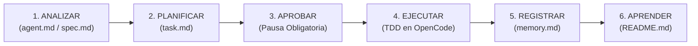

# FOBANDOR — Build. Advertise. Entertain. With AI.

> *"TU VISIÓN. NUESTRA TECNOLOGÍA. SIN LÍMITES."*  
> Plataforma web comercial, transaccional y de gestión (*Backoffice CMS + CRM + Fulfillment + Customer Portal*) para servicios avanzados de inteligencia artificial.

---

## 📋 Tabla de Contenidos
1. [Objetivos y Contexto de Negocio](#1-objetivos-y-contexto-de-negocio)
2. [Stack Tecnológico y Principios](#2-stack-tecnológico-y-principios)
3. [Estrategia "Zero External CDN"](#3-estrategia-zero-external-cdn)
4. [Diagrama de Arquitectura de la Solución](#4-diagrama-de-arquitectura-de-la-solución)
5. [Estructura de Archivos del Proyecto](#5-estructura-de-archivos-del-proyecto)
6. [Secciones del Sitio y Matriz de Roles (RBAC)](#6-secciones-del-sitio-y-matriz-de-roles-rbac)
7. [Puesta en Marcha Local (Linux Ubuntu)](#7-puesta-en-marcha-local-linux-ubuntu)
8. [Metodología HARNESS y Gobernanza Multi-Agente](#8-metodología-harness-y-gobernanza-multi-agente)
9. [Hoja de Ruta Macro (Roadmap)](#9-hoja-de-ruta-macro-roadmap)
10. [Autor y Agradecimientos](#10-autor-y-agradecimientos)

---

## 1. Objetivos y Contexto de Negocio

* **Emprendedor / Cliente:** Freddy Obando (Orlando, Florida, Estados Unidos).
* **Marca Oficial:** **FOBANDOR** (`www.fobandor.com`).
* **Público Objetivo:** Comunidad hispanohablante y mercado estadounidense general (sitio 100% bilingüe Español / Inglés).
* **Catálogo Central (4 Líneas de Servicio Administrables):**
  1. **Desarrollo Web con IA:** Sitios corporativos, e-commerce, landing pages, chatbots y automatización.
  2. **Desarrollo de Apps con IA:** Aplicaciones móviles iOS/Android, web apps, sistemas a medida y APIs.
  3. **Publicidad con IA:** Campañas de anuncios, videos para redes sociales, creatividades, avatares y copywriting.
  4. **Fobandor Studios:** Producción audiovisual con IA (series, películas, podcasts, trailers, cortometrajes y videoclips).
* **Modelo Transaccional Core:** Modelo prepago recurrente mensual vinculado a un compromiso de entrega estricto con SLA de 7 días (`FulfillmentOrder`) y renovación automática vía Stripe Webhooks.

---

## 2. Stack Tecnológico y Principios

| Capa | Tecnología Seleccionada | Justificación y Notas |
| :--- | :--- | :--- |
| **Backend** | **Python 3.14.4** + **Django 5.2 LTS** | Estabilidad LTS, compatibilidad nativa con Python 3.14 y Clean Architecture (*Thin Models/Views*, `services.py`, `selectors.py`). |
| **Base de Datos** | **PostgreSQL 16+** en **Docker** | Paridad Dev/Prod (12-Factor X), zona horaria UTC nativa con visualización `America/New_York` (Florida). |
| **Frontend** | **100% Server-Driven** (DTL + HTMX + Alpine.js + Tailwind) | Sin frameworks SPA (React/Vue). Máximo SEO, bajo costo de mantenimiento y carga instantánea. |
| **Estilos** | **Tailwind CSS 3.4+** | Paleta corporativa FOBANDOR, tipografía Montserrat y soporte `darkMode: 'class'`. |
| **Pagos** | **Stripe SDK** | Stripe Checkout (suscripciones y cupones), Customer Portal, Webhooks firmados y soporte jerárquico para API moderna de Stripe (`pricing.price_details.price`). |
| **Email Transaccional** | **Google Workspace SMTP** | Despacho vía `smtp.gmail.com:587` (TLS), confirmaciones de compra con enlace a PDF de factura Stripe y alertas internas inmediatas para Staff + `Content_Editors`. |
| **Captura de Leads** | **Formspree.io (AJAX Fetch)** | Formularios de contacto y diagnóstico comercial in-situ sin recarga de página, con honeypot anti-spam (`_gotcha`), asunto configurable y alerta directa a `for@fobandor.com`. |
| **Infraestructura** | **Docker Swarm / Traefik / WhiteNoise** | Despliegue en KVM VPS (Hostinger), SSL automático Let's Encrypt con Traefik, WhiteNoise para compilar y servir estáticos de forma inmutable y blindaje OWASP. |

---

## 3. Estrategia "Zero External CDN"

Para garantizar inmunidad contra redes con bloqueos corporativos, firewalls institucionales y estricto cumplimiento de privacidad (GDPR / AVS):
* **Fuentes Montserrat:** Alojadas localmente en formato variable WOFF2 (`static/fonts/montserrat/`) y servidas vía `@font-face` local (pesos 400 a 700).
* **Librerías JS Vendor:** **HTMX 2.x** y **Alpine.js 3.x** minificados y alojados en `static/js/vendor/`.
* **Cero dependencias externas:** La plataforma no realiza ninguna petición HTTP hacia CDNs públicos externos durante la carga.

---

## 4. Diagrama de Arquitectura de la Solución

```mermaid
flowchart TD
    %% =========================================================================
    %% CAPA 1: USUARIOS Y CLIENTES
    %% =========================================================================
    subgraph Actores["1. Actores y Dispositivos (Desktop / Tablet / Mobile)"]
        User_Public["Visitante Web (Mercado Latino & USA)\n[Navegación ES/EN, Dark/Light Mode]"]
        User_Client["Cliente Registrado y Verificado\n[Portal /mi-cuenta/, SLA Entregas, Billing]"]
        User_Staff["Equipo Interno FOBANDOR (RBAC)\n[Superadmin, Editor CMS, Operador Studio]"]
    end

    %% =========================================================================
    %% CAPA 2: EDGE, INGRESS Y ZERO-CDN ASSETS
    %% =========================================================================
    subgraph Edge["2. Ingress & Entrega Estática (Zero External CDN)"]
        Nginx["Nginx Reverse Proxy / SSL\n(Terminación TLS, Rate Limiting, Gzip)"]
        
        subgraph StaticAssets["Archivos Estáticos Locales (static/)"]
            FontsLocal["Montserrat WOFF2 Local\n(@font-face sin llamadas externas)"]
            JSLocal["HTMX 2.x & Alpine.js 3.x Locales\n(A prueba de bloqueos de red)"]
            CSSLocal["Tailwind CSS Compilado\n(Paleta FOBANDOR + dark:class)"]
            FaviconsLocal["Set de Favicons Oficiales\n(Generados desde logo-fobandor.jpg)"]
        end

        subgraph MediaAssets["Archivos Media (media/)"]
            MediaFiles["Imágenes CMS, Portafolios y\nEntregables Digitales (Pillow)"]
        end
    end

    %% =========================================================================
    %% CAPA 3: AMBIENTE DOCKERIZADO (DEV / PROD PARITY)
    %% =========================================================================
    subgraph DockerCompose["3. Ecosistema Docker (Paridad Dev / Prod)"]
        
        subgraph AppContainer["Contenedor Aplicación Web (Django 5.2 LTS / Python 3.12+ / Gunicorn)"]
            Core12Factor["Núcleo Django 12-Factor\n(django-environ, i18n ES/EN, Security)"]
            
            subgraph ModulosApp["Módulos de Aplicación (Thin Views / Models)"]
                App_Users["fobandor.users\nCustomUser, Gate Verificación Email, RBAC"]
                App_CMS["fobandor.cms\nServicios (4 Líneas), Proyectos, RRSS, Seeders"]
                App_Billing["fobandor.billing\nPlanes, Stripe Checkout, Webhooks, Portal"]
                App_Fulfillment["fobandor.fulfillment\nMotor SLA 7 Días (FulfillmentOrder)"]
                App_Core["fobandor.core\nHome Hero, Navegación, Switchers"]
            end

            subgraph CleanArch["Capa de Lógica de Negocio (Clean Architecture)"]
                Services["services.py\n(Mutaciones, API Stripe, Envíos de Correo)"]
                Selectors["selectors.py\n(Consultas y filtros optimizados ORM)"]
            end
        end

        subgraph DBContainer["Contenedor Base de Datos (PostgreSQL 16+)"]
            PostgreSQL[("PostgreSQL 16+ Engine\n(UTC Nativo + Vista America/New_York)")]
            DBVolume[("Volumen Persistente\npostgres_data")]
            PostgreSQL --- DBVolume
        end
    end

    %% =========================================================================
    %% CAPA 4: SERVICIOS EXTERNOS E INFRAESTRUCTURA VPS
    %% =========================================================================
    subgraph Externos["4. Ecosistema Externo e Infraestructura"]
        subgraph StripeServices["Stripe Payment Infrastructure"]
            StripeCheckout["Stripe Checkout (Suscripciones + Cupones)"]
            StripePortal["Stripe Customer Portal (Autogestión)"]
            StripeWebhook["Webhooks Firmados (checkout.session.completed, invoice.paid)"]
        end

        subgraph TransactionalMail["Email Transaccional (Google SMTP)"]
            MailActivation["Correo de Activación Obligatoria"]
            MailDelivery["Notificaciones de Compra y Alertas SLA"]
        end

        subgraph LeadCapture["Captura de Leads (Formspree)"]
            FormspreeAPI["Formspree.io Endpoint\n(Honeypot _gotcha, Notificación for@fobandor.com)"]
        end

        subgraph HostingVPS["Hosting Agnóstico (Producción)"]
            VPS["Hostinger VPS / Otro Proveedor VPS\n(Despliegue con Docker Compose / EasyPanel)"]
        end
    end

    %% =========================================================================
    %% CONEXIONES Y FLUJOS DE DATOS (SOLO NODO A NODO)
    %% =========================================================================
    User_Public -->|"HTTPS / HTMX"| Nginx
    User_Client -->|"HTTPS / HTMX"| Nginx
    User_Staff -->|"HTTPS / HTMX"| Nginx

    Nginx --> CSSLocal
    Nginx --> JSLocal
    Nginx --> FontsLocal
    Nginx --> FaviconsLocal
    Nginx --> MediaFiles
    Nginx --> Core12Factor

    Core12Factor --> App_Core
    Core12Factor --> App_Users
    Core12Factor --> App_CMS
    Core12Factor --> App_Billing
    Core12Factor --> App_Fulfillment

    App_Users --> Services
    App_CMS --> Selectors
    App_Billing --> Services
    App_Fulfillment --> Services

    Services -->|"Lectura / Escritura ORM"| PostgreSQL
    Selectors -->|"Consultas Optimizadas"| PostgreSQL

    Services -->|"Crear Sesión Checkout"| StripeCheckout
    Services -->|"Crear Sesión Billing Portal"| StripePortal
    StripeWebhook -->|"Eventos Firmados /stripe/webhook/"| App_Billing
    App_Billing -->|"Dispara Orden SLA 7 Días"| App_Fulfillment

    Services -->|"Envío Token Verificación"| MailActivation
    App_Fulfillment -->|"Aviso de Entrega Completada"| MailDelivery
    User_Public -->|"Solicitud Diagnóstico (AJAX Fetch)"| FormspreeAPI
    FormspreeAPI -->|"Alerta de Lead por Correo"| User_Staff

    Core12Factor -.->|"Despliegue Idéntico Docker"| VPS
```



---

## 5. Estructura de Archivos del Proyecto

```text
fobandor/
├── .env.example              # Plantilla documentada de variables de entorno
├── .gitignore                # Reglas estrictas de exclusión (secretos, venv, node)
├── .flake8                   # Configuración de linter PEP8
├── pytest.ini                # Configuración de pruebas automatizadas con Django
├── docker-compose.yml        # Orquestación de PostgreSQL 16 con volumen persistente
├── manage.py                 # Punto de entrada de comandos Django
├── package.json              # Dependencias y scripts de compilación de Tailwind CSS
├── tailwind.config.js        # Configuración de paleta FOBANDOR y dark mode
├── requirements/
│   ├── base.txt              # Dependencias de producción (Django 5.2 LTS, psycopg, Pillow, environ)
│   └── local.txt             # Dependencias de desarrollo y test (pytest, flake8)
├── config/
│   ├── __init__.py
│   ├── urls.py               # Enrutador principal con soporte i18n_patterns y /i18n/setlang/
│   ├── wsgi.py               # Entrada WSGI para producción
│   ├── asgi.py               # Entrada ASGI
│   └── settings/
│       ├── __init__.py
│       ├── base.py           # Configuración común 12-Factor, LocaleMiddleware y apps
│       ├── local.py          # Configuración local de desarrollo con base de datos y fallback
│       └── production.py     # Configuración para servidor VPS en producción
├── fobandor/
│   ├── __init__.py
│   ├── core/                 # Aplicación de vistas estáticas, landing page y utilidades
│   │   ├── apps.py
│   │   ├── urls.py
│   │   └── views.py
│   ├── users/                # Aplicación de identidad, CustomUser y RBAC
│   │   ├── admin.py          # Panel de administración bilingüe y organizado por fieldsets
│   │   ├── apps.py
│   │   ├── models.py         # Modelo User con UserManager personalizado (login por email)
│   │   └── tests/
│   ├── cms/                  # Gestión de contenido bilingüe (4 líneas de servicio, proyectos, RRSS, empresa)
│   │   ├── admin.py
│   │   ├── models.py
│   │   └── management/commands/
│   ├── billing/              # Motor de pagos, Checkout, Webhooks y notificaciones por correo
│   │   ├── models.py         # SubscriptionPlan, CustomerSubscription, BillingInvoice
│   │   ├── services.py       # Lógica Stripe, webhooks idempotentes y despacho de emails
│   │   ├── urls.py
│   │   ├── views.py
│   │   └── tests/            # Cobertura TDD para webhooks y pasarela
│   ├── fulfillment/          # Motor operativo SLA a 7 días
│   │   ├── models.py         # FulfillmentOrder con opciones de servicio bilingües
│   │   └── management/commands/reconcile_fulfillment_orders.py # Auto-reconciliación
│   └── portal/               # Portal de autoservicio del cliente (/mi-cuenta/)
│       ├── urls.py
│       └── views.py
├── static/
│   ├── css/
│   │   ├── input.css         # Directivas Tailwind, reglas @font-face locales y contraste de inputs
│   │   └── output.css        # CSS compilado y optimizado
│   ├── fonts/
│   │   └── montserrat/       # Archivos WOFF2 de fuente variable Montserrat
│   ├── js/
│   │   └── vendor/           # HTMX 2.0 y Alpine.js 3.14 locales
│   └── images/
│       └── favicons/         # Favicons e iconos multiplataforma generados
├── media/                    # Almacenamiento seguro de entregables y multimedia
├── locale/                   # Catálogos de internacionalización (.po y .mo)
│   └── en/
│       └── LC_MESSAGES/
├── scripts/                  # Scripts de utilidades operativas y mantenimiento
│   ├── generate_favicons.py  # Generador de favicons con Pillow
│   └── build_translations.py # Compilador de traducciones con polib
└── templates/
    ├── base.html             # Layout maestro con script anti-FOUC y meta tags
    ├── partials/
    │   ├── navbar.html       # Navegación responsive, switcher de idioma y dark toggle
    │   └── footer.html       # Enlaces institucionales, redes oficiales y copyright
    ├── pages/
    │   └── home.html         # Hero Section, misión/visión/valores y showcase de las 4 líneas
    ├── billing/
    │   ├── pricing.html      # Selector interactivo de planes con Alpine.js
    │   └── email/            # Plantillas transaccionales de compra (cliente y equipo interno)
    │       ├── customer_purchase_invoice.html / .txt
    │       └── internal_purchase_alert.html / .txt
    ├── backoffice/           # Panel administrativo Server-Driven (CMS, finanzas y entregas SLA)
    ├── portal/               # Dashboard de cliente y formulario de facturación AVS
    └── account/              # Embudo corporativo bilingüe Allauth (signup, login, confirmación)
```

---

## 6. Secciones del Sitio y Matriz de Roles (RBAC)

### Secciones Públicas y Portales
* **Web Pública (`/es/` / `/en/`):** Inicio (Hero), Servicios (4 líneas), Proyectos, Precios/Planes, Nosotros y Contacto.
* **Captura de Leads y Diagnóstico Comercial (Formspree):** Modal de diagnóstico en `/es/precios/` y formulario de contacto en la Home procesados de forma asíncrona mediante Fetch API hacia Formspree (`FORMSPREE_ENDPOINT`), con protección honeypot invisible (`_gotcha`), confirmación in-situ con Alpine.js sin abandonar el sitio, y despacho directo a `for@fobandor.com`. Textos de éxito y asunto parametrizables desde el CMS (`CompanyProfile`).
* **Portal de Autoservicio (`/mi-cuenta/`):** Gestión de perfil, facturación AVS, historial y descarga de entregables del SLA a 7 días, y enlace seguro al **Stripe Customer Portal**.
* **Backoffice Administrativo (`/backoffice/`):** Panel integral Server-Driven con DTL + HTMX.

### Matriz de Permisos RBAC

| Rol | Guard de Seguridad | Permisos y Alcance |
| :--- | :--- | :--- |
| **Superadministrador** | `is_superuser = True` | Control total del sistema: usuarios internos, configuración global, planes, cupones, transacciones de Stripe y auditoría. |
| **Editor de Contenido** | Grupo `Content_Editors` | CRUD bilingüe sobre el CMS (4 líneas de servicio, proyectos, misión, visión y redes sociales oficiales). Sin acceso a finanzas ni datos de clientes. |
| **Operador Studio** | Grupo `Fulfillment_Operators` | Visualización del semáforo del SLA a 7 días en la cola de `FulfillmentOrder`, descarga de especificaciones y carga de entregables digitales marcando la orden como `ENTREGADA`. |
| **Cliente Registrado** | `is_staff = False` | Acceso exclusivo al portal `/mi-cuenta/` tras verificar su correo electrónico (`is_email_verified = True`). |

---

## 7. Puesta en Marcha Local (Linux Ubuntu)

### Prerrequisitos
* Sistema Operativo Ubuntu / Debian con `python3` (3.12+), `node` (v20+), `npm` y `docker` instalados.

### Paso 1: Clonar y Acceder al Proyecto
```bash
git clone https://github.com/javieresquivelt-ux/fobandor-web.git
cd fobandor-web
```

### Paso 2: Configurar Variables de Entorno
```bash
cp .env.example .env
```
Asegúrate de definir las credenciales locales de PostgreSQL, llaves de Stripe (`STRIPE_PUBLIC_KEY`, `STRIPE_SECRET_KEY`, `STRIPE_WEBHOOK_SECRET`), configuración SMTP para despachos de correo, y el endpoint de captura de leads `FORMSPREE_ENDPOINT` (`https://formspree.io/f/mqpqqggk`).

### Paso 3: Iniciar la Base de Datos con Docker Compose
```bash
docker compose up -d
```
Verifica que el contenedor esté saludable:
```bash
docker compose ps
```

### Paso 4: Entorno Virtual y Dependencias de Python
```bash
python3 -m venv .venv
source .venv/bin/activate
pip install -r requirements/local.txt
```

### Paso 5: Compilar Tailwind CSS
```bash
npm install
npm run build:css
```
*(Para desarrollo con recarga en vivo de estilos, ejecuta en otra terminal `npm run watch:css`).*

### Paso 6: Aplicar Migraciones, Sembrar Contenido y Crear Superusuario
```bash
python manage.py migrate
python manage.py seed_initial_content
python manage.py seed_subscription_plans
python manage.py create_rbac_groups
python manage.py createsuperuser
```

### Paso 7: Ejecutar Suite de Pruebas y Servidor
```bash
pytest
python manage.py runserver 0.0.0.0:8000
```
Visita en tu navegador:
* **Web Pública:** `http://localhost:8000/` (redirige automáticamente a `http://localhost:8000/es/`).
* **Catálogo de Planes y Precios:** `http://localhost:8000/es/precios/`.
* **Portal de Autoservicio del Cliente:** `http://localhost:8000/es/mi-cuenta/` (requiere login o Google Social Account).
* **Backoffice Staff:** `http://localhost:8000/es/backoffice/` (requiere login con `is_staff=True`).
* **Django Admin:** `http://localhost:8000/es/admin/`.

---

## 8. Metodología HARNESS y Gobernanza Multi-Agente

El desarrollo de FOBANDOR se ejecuta bajo el ciclo riguroso de **HARNESS Framework** con gobernanza multi-agente:



* **Fase de Diseño y Planificación (Antigravity-IDE):** Arquitectura limpia, modelado relacional, especificaciones de seguridad y descomposición atómica de tareas.
* **Fase de Ejecución y Verificación (OpenCode / DeepSeek V4 Pro):** Implementación de código fuertemente tipado, modular y probado con `pytest`.

---

## 9. Hoja de Ruta Macro (Roadmap)

* [x] **Etapa 1 — Cimientos, Branding y UI Base en `localhost`:** Django 5.2 LTS, PostgreSQL 16 en Docker, Tailwind CSS con paleta oficial, favicons, fuentes locales Montserrat, i18n ES/EN y Dark/Light Mode.
* [x] **Etapa 2 — Identidad, RBAC y Backoffice CMS:** Modelos dinámicos del CMS para las 4 líneas (`fobandor.cms`), proyectos, seeder con datos reales de Orlando, FL, grupos de permisos RBAC y panel `/backoffice/` modular con DTL + HTMX + Tailwind.
* [x] **Etapa 3 — Registro de Clientes, Autenticación Gmail, Stripe Checkout, Motor SLA 7 Días y Planes Reales:** Registro con verificación previa, Social Login con Gmail (Google OAuth 2.0 / `django-allauth`), formulario de facturación AVS, Planes de Acompañamiento oficiales de Freddy Obando ($697, $1,297, $1,997 USD) administrables dinámicamente desde `/backoffice/planes/`, diagnóstico Formspree, Webhooks firmados criptográficamente y motor de órdenes `FulfillmentOrder` (SLA 7 días).
* [x] **Etapa 4 — SEO Técnico, Auditoría OWASP y Despliegue en VPS:** Sitemap dinámico, Open Graph, suite de pruebas `pytest`, auditoría de seguridad y despliegue en KVM VPS (Hostinger) con Docker Swarm, EasyPanel y Traefik SSL.
* [x] **Etapa 5 — Refinamiento Integral de UX y CMS:** Misión, Visión y Valores dinámicos en la landing desde `CompanyProfile`, selector de idioma `/i18n/setlang/`, enlaces canónicos, formulario en contacto, switches de visibilidad de secciones y retorno canónico al portal de cliente.
* [x] **Etapa 6 — UX/UI de Precios y Embudo Allauth:** Contraste universal en inputs en `static/css/input.css`, selector interactivo de planes con Alpine.js en `/precios/` y maquetación corporativa bilingüe del embudo de autenticación Allauth.
* [x] **Etapa 7 — Servidor SMTP de Google Workspace:** Integración de Google SMTP (`smtp.gmail.com:587` TLS) con contraseñas de aplicación para verificación obligatoria de correo y reseteo de claves con tolerancia a caídas de socket.
* [x] **Etapa 8 — Resiliencia Multi-Fuente en Webhooks y Backoffice SLA:** Mitigación de la condición de carrera entre `invoice.paid` y `checkout.session.completed`, backfill bidireccional de órdenes huérfanas y comando `reconcile_fulfillment_orders`.
* [x] **Etapa 9 — Notificaciones Transaccionales de Compra por Correo:** Envío automático de confirmación con enlace al PDF oficial de Stripe al cliente y alerta operativa en hora de Florida (`America/New_York`) para el Staff y grupo `Content_Editors`.
* [x] **Etapa 10 — Blindaje de Webhooks ante API Moderna de Stripe:** Soporte jerárquico de precios para `pricing.price_details.price` y compatibilidad con `StripeObject`, inyección SMTP en Docker Swarm VPS y reconciliación E2E.
* [x] **Etapa 11 — Optimización UX de Notificaciones por Correo:** Rediseño minimalista de alerta interna con estilos 100% inline (legibilidad universal en Gmail), enlace canónico al portal del cliente `reverse("portal:dashboard")` (`/es/mi-cuenta/`) y simplificación sobria de firmas.

---

## 10. Autor y Agradecimientos

* **Desarrollador Fullstack Líder:** [Javier Esquivel T.](https://github.com/javieresquivelt-ux) (Chile).
* **Cliente / Emprendedor:** Freddy Obando — Fundador de **FOBANDOR** (Orlando, Florida, EE.UU.).
* **Plataforma y Asistencia de Arquitectura:** Antigravity-IDE (Google DeepMind) y OpenCode (DeepSeek V4 Pro).

---
© 2026 FOBANDOR. Todos los derechos reservados.

