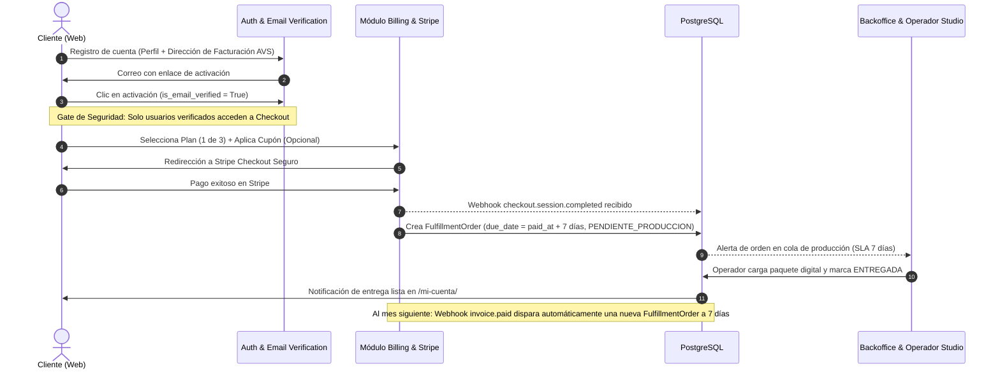
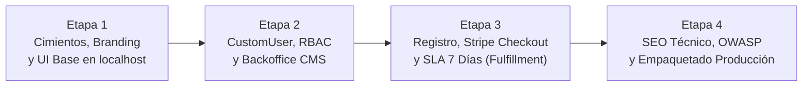

# Informe de Entendimiento y Arquitectura Técnica — Plataforma FOBANDOR

> **Destinatario:** Desarrollador Fullstack Líder (Chile)  
> **Arquitecto / Asesor:** Antigravity AI — Arquitectura de Software e Ingeniería de Datos  
> **Fecha:** 14 de Noviembre de 2026  
> **Metodología:** HARNESS Framework (Iteración incremental por etapas)  
> **Estado Actual:** FASE 1 (ANALIZAR) y FASE 2 (PLANIFICAR) completadas para la **Etapa 1**. En **FASE 3 (APROBAR v2)** — plan de corrección emitido, pendiente de revisión y validación.

---

## 1. Resumen Ejecutivo y Visión General

El proyecto **FOBANDOR** corresponde a una plataforma web comercial, transaccional y de gestión (*Backoffice CMS + CRM + Fulfillment + Customer Portal*) para el emprendimiento de **Freddy Obando**, radicado en Orlando, Florida, EE.UU.

La propuesta de valor de la marca (*"BUILD. ADVERTISE. ENTERTAIN. WITH AI."*) articula servicios digitales avanzados impulsados por inteligencia artificial orientados tanto a la comunidad hispanohablante como al mercado estadounidense angloparlante.

Como desarrollador fullstack en Chile construyendo para un cliente y operación en EE.UU., se establece un marco de trabajo de alta ingeniería:
* **Entorno inicial limpio:** Partimos desde cero en el repositorio, sin dependencias residuales ni código heredado.
* **Disciplina tecnológica estricta:** Stack 100% Server-Driven en Django 5.2 LTS + PostgreSQL + HTMX + Alpine.js + Tailwind CSS, descartando expresamente SPAs pesadas (React/Vue).
* **Seguridad y Cumplimiento:** Estándar PCI-DSS (sin tocar datos de tarjeta), AVS para validación de dirección en Stripe, verificación previa de correo electrónico y trazabilidad legal de términos.
* **Gobernanza HARNESS:** Ninguna línea de código de producción se implementa sin un plan atómico aprobado previamente en `task.md`.

---

## 2. Entendimiento del Modelo de Negocio y Reglas Clave

### A. Catálogo Dinámico de 4 Líneas de Servicio (Administrables y Precargadas)
1. **Desarrollo Web con IA:** Sitios corporativos, e-commerce, landing pages, chatbots/asistentes IA, automatización.
2. **Desarrollo de Apps con IA:** Aplicaciones móviles iOS/Android, web apps, apps con asistentes IA, sistemas a medida, APIs.
3. **Publicidad con IA:** Campañas de anuncios, videos para redes sociales, creatividades con IA, avatares y personajes, copywriting y automatización publicitaria.
4. **Fobandor Studios (Producción Audiovisual con IA):** Series, películas, podcasts, trailers, cortometrajes, videoclips y contenido para YouTube/redes.

### B. El Ciclo Prepago + SLA 7 Días + Renovación Recurrente (Core Transaccional)
El modelo de monetización principal no es una simple venta spot, sino un **servicio mensual recurrente con compromiso de entrega estricto (SLA de 7 días)**:

### C. Gate de Seguridad y Registro Riguroso
Para mitigar fraude y asegurar cumplimiento fiscal (EE.UU. / Internacional):
1. **Verificación de Email Previa:** El botón o enlace a Stripe Checkout está bloqueado hasta que el usuario activa su cuenta vía email.
2. **Campos E.164 y AVS:** Se capturan teléfono en formato internacional y dirección de facturación completa (País ISO-2, Estado, Ciudad, ZIP Code, Líneas de dirección) para alimentar el sistema *Address Verification System* (AVS) de Stripe.
3. **Cero datos sensibles en BD local:** Se prohíbe taxativamente almacenar números de tarjeta, CVV o vencimientos. Se vincula exclusivamente mediante `stripe_customer_id` y `stripe_subscription_id`.
4. **Autenticación Híbrida (Email/Password + Cuentas Gmail):**
   * **Cuentas Gmail (Google OAuth 2.0):** Los clientes pueden registrarse con su cuenta Gmail en 1 clic. Su correo queda inmediatamente verificado (`is_email_verified = True`), eliminando el tiempo de espera por email de confirmación. Tras el login, completan sus datos de facturación AVS para Stripe.
   * **Google Workspace (Nota de Arquitectura):** La integración corporativa para dominios empresariales `@fobandor.com` queda debidamente documentada y diseñada para una fase futura, manteniéndose fuera del plan de ejecución activo.

---

## 3. Arquitectura Tecnológica y Patrones de Diseño

```mermaid
flowchart TD
    %% =========================================================================
    %% CAPA 1: USUARIOS Y CLIENTES
    %% =========================================================================
    subgraph Actores["1. Actores y Dispositivos (Desktop / Tablet / Mobile)"]
        User_Public["Visitante Web (Mercado Latino & USA)\n[Navegación ES/EN, Dark/Light Mode]"]
        User_Client["Cliente Registrado y Verificado\n[Portal /mi-cuenta/, SLA Entregas, Billing]"]
        User_Staff["Equipo Interno FOBANDOR (RBAC)\n[Superadmin, Editor CMS, Operador Studio]"]
    end

    %% =========================================================================
    %% CAPA 2: EDGE, INGRESS Y ZERO-CDN ASSETS
    %% =========================================================================
    subgraph Edge["2. Ingress & Entrega Estática (Zero External CDN)"]
        Nginx["Nginx Reverse Proxy / SSL\n(Terminación TLS, Rate Limiting, Gzip)"]
        
        subgraph StaticAssets["Archivos Estáticos Locales (static/)"]
            FontsLocal["Montserrat WOFF2 Local\n(@font-face sin llamadas externas)"]
            JSLocal["HTMX 2.x & Alpine.js 3.x Locales\n(A prueba de bloqueos de red)"]
            CSSLocal["Tailwind CSS Compilado\n(Paleta FOBANDOR + dark:class)"]
            FaviconsLocal["Set de Favicons Oficiales\n(Generados desde logo-fobandor.jpg)"]
        end

        subgraph MediaAssets["Archivos Media (media/)"]
            MediaFiles["Imágenes CMS, Portafolios y\nEntregables Digitales (Pillow)"]
        end
    end

    %% =========================================================================
    %% CAPA 3: AMBIENTE DOCKERIZADO (DEV / PROD PARITY)
    %% =========================================================================
    subgraph DockerCompose["3. Ecosistema Docker (Paridad Dev / Prod)"]
        
        subgraph AppContainer["Contenedor Aplicación Web (Django 5.2 LTS / Python 3.12+ / Gunicorn)"]
            Core12Factor["Núcleo Django 12-Factor\n(django-environ, i18n ES/EN, Security)"]
            
            subgraph ModulosApp["Módulos de Aplicación (Thin Views / Models)"]
                App_Users["fobandor.users\nCustomUser, Gate Verificación Email, RBAC"]
                App_CMS["fobandor.cms\nServicios (4 Líneas), Proyectos, RRSS, Seeders"]
                App_Billing["fobandor.billing\nPlanes, Stripe Checkout, Webhooks, Portal"]
                App_Fulfillment["fobandor.fulfillment\nMotor SLA 7 Días (FulfillmentOrder)"]
                App_Core["fobandor.core\nHome Hero, Navegación, Switchers"]
            end

            subgraph CleanArch["Capa de Lógica de Negocio (Clean Architecture)"]
                Services["services.py\n(Mutaciones, API Stripe, Envíos de Correo)"]
                Selectors["selectors.py\n(Consultas y filtros optimizados ORM)"]
            end
        end

        subgraph DBContainer["Contenedor Base de Datos (PostgreSQL 16+)"]
            PostgreSQL[("PostgreSQL 16+ Engine\n(UTC Nativo + Vista America/New_York)")]
            DBVolume[("Volumen Persistente\npostgres_data")]
            PostgreSQL --- DBVolume
        end
    end

    %% =========================================================================
    %% CAPA 4: SERVICIOS EXTERNOS E INFRAESTRUCTURA VPS
    %% =========================================================================
    subgraph Externos["4. Ecosistema Externo e Infraestructura"]
        subgraph StripeServices["Stripe Payment Infrastructure"]
            StripeCheckout["Stripe Checkout (Suscripciones + Cupones)"]
            StripePortal["Stripe Customer Portal (Autogestión)"]
            StripeWebhook["Webhooks Firmados (checkout.session.completed, invoice.paid)"]
        end

        subgraph TransactionalMail["Email Transaccional (SMTP)"]
            MailActivation["Correo de Activación Obligatoria"]
            MailDelivery["Notificación de Paquete Digital Listo"]
        end

        subgraph HostingVPS["Hosting Agnóstico (Producción)"]
            VPS["Hostinger VPS / Otro Proveedor VPS\n(Despliegue con Docker Compose / EasyPanel)"]
        end
    end

    %% =========================================================================
    %% CONEXIONES Y FLUJOS DE DATOS (SOLO NODO A NODO)
    %% =========================================================================
    User_Public -->|"HTTPS / HTMX"| Nginx
    User_Client -->|"HTTPS / HTMX"| Nginx
    User_Staff -->|"HTTPS / HTMX"| Nginx

    Nginx --> CSSLocal
    Nginx --> JSLocal
    Nginx --> FontsLocal
    Nginx --> FaviconsLocal
    Nginx --> MediaFiles
    Nginx --> Core12Factor

    Core12Factor --> App_Core
    Core12Factor --> App_Users
    Core12Factor --> App_CMS
    Core12Factor --> App_Billing
    Core12Factor --> App_Fulfillment

    App_Users --> Services
    App_CMS --> Selectors
    App_Billing --> Services
    App_Fulfillment --> Services

    Services -->|"Lectura / Escritura ORM"| PostgreSQL
    Selectors -->|"Consultas Optimizadas"| PostgreSQL
    PostgreSQL --- DBVolume

    Services -->|"Crear Sesión Checkout"| StripeCheckout
    Services -->|"Crear Sesión Billing Portal"| StripePortal
    StripeWebhook -->|"Eventos Firmados /stripe/webhook/"| App_Billing
    App_Billing -->|"Dispara Orden SLA 7 Días"| App_Fulfillment

    Services -->|"Envío Token Verificación"| MailActivation
    App_Fulfillment -->|"Aviso de Entrega Completada"| MailDelivery

    Core12Factor -.->|"Despliegue Idéntico Docker"| VPS
```

### Principios Arquitectónicos Aplicados:
* **Thin Models & Thin Views:** La lógica pesada de negocio (crear órdenes de fulfillment al recibir webhooks, enviar correos, generar sesiones Stripe) reside en funciones puras en `services.py`. Las consultas complejas residen en `selectors.py`.
* **Zero-SPA Overhead:** Se evita la complejidad innecesaria, dependencias masivas y desincronización de estado de React/Vue. HTMX gestiona la reactividad en Backoffice y Portal de Cliente; Alpine.js maneja exclusivamente el estado visual efímero (toggle de modo oscuro y aperturas de menú).
* **Portabilidad 12-Factor:** Toda credencial sensible (Stripe keys, DB credentials, Django secret key) se alimenta mediante variables `.env`. El sistema funcionará idéntico en desarrollo local en Ubuntu como en cualquier VPS de producción montado sobre Docker + Gunicorn + Nginx.

---

## 4. Estado de los Artefactos de Gobierno HARNESS

En cumplimiento estricto con el Bloque 1 y las Instrucciones de Arranque, se han generado en la raíz del proyecto los siguientes documentos rectores:

| Documento | Estado | Propósito y Contenido |
| :--- | :---: | :--- |
| [agent.md](file:///home/jet/proyectos_lnx/proyectos/fobandor/agent.md) | **Creado** | Identidad del sistema, rol de Arquitecto Senior, disciplina de stack y gobernanza multi-agente (Antigravity + OpenCode). |
| [spec.md](file:///home/jet/proyectos_lnx/proyectos/fobandor/spec.md) | **Creado** | Especificación integral de FOBANDOR: negocio, paleta, catálogo de 4 líneas, diagramas Mermaid, módulos Django y seguridad. |
| [task.md](file:///home/jet/proyectos_lnx/proyectos/fobandor/task.md) | **Creado** | Plan atómico desglosado para la **Etapa 1** (Cimientos, Branding y UI Base en `localhost`). |
| [informe_entendimiento.md](file:///home/jet/proyectos_lnx/proyectos/fobandor/informe_entendimiento.md) | **Creado** | Informe de entendimiento arquitectónico y funcional disponible en el repositorio local. |
| `memory.md` | **Creado (activo)** | Bitácora de ADRs (001-011) y decisiones arquitectónicas. Actualizada con las correcciones v2. |
| `README.md` | *Pendiente* | Se actualizará en la fase **6. APRENDER** al consolidar la Etapa 1. |

---

## 5. Hoja de Ruta Macro por Etapas

* **Etapa 1 (Activa — Esperando Aprobación):**
  * Estructura limpia de proyecto Django 5.2 LTS y configuración 12-Factor (`config/settings/base.py`, `local.py`).
  * Definición de `CustomUser` inicial (`AUTH_USER_MODEL = 'users.User'`) para blindar el esquema de base de datos desde la migración 0001.
  * Configuración de PostgreSQL 16+ local con Docker Compose (`docker-compose.yml`).
  * Tailwind CSS con la paleta de FOBANDOR (`#FF6A00`, `#2563EB`, `#06B6D4`, `#0D1117`, `#F3F4F6`) y fuente `Montserrat` descargada en local (Zero External CDN).
  * Generación y enlace del set completo de favicons e iconos desde `instructions/logo-fobandor.jpg`.
  * Maquetación bilingüe (ES por defecto / EN) con `LocaleMiddleware`.
  * Switcher Dark/Light mode persistido en `localStorage` vía Alpine.js.
  * Hero Section y showcase de las 4 líneas de negocio en la Home para demostración en `http://localhost:8000`.

* **Etapa 2:**
  * Control de acceso basado en roles (Superadmin, Editor de Contenido, Operador de Entregas).
  * Modelos CMS dinámicos para Servicios, Proyectos, Nosotros, Redes Sociales y Contacto.
  * Comando de seeder para precargar datos reales de Orlando y enlaces oficiales.
  * Panel administrativo en `/backoffice/` con interactividad HTMX.

* **Etapa 3:**
  * Flujo de registro de cliente y autenticación híbrida: Email/Password + Social Login con cuentas Gmail (Google OAuth 2.0).
  * Verificación inmediata de email para Gmail (`is_email_verified = True`) y formulario de captura AVS para Stripe.
  * Integración con Stripe Checkout (3 planes mensuales administrables + cupones de descuento).
  * Webhook listener verificado (`/stripe/webhook/`) para procesar cobros y renovaciones.
  * Modelo `FulfillmentOrder` (SLA 7 días) con vista de operador y notificaciones.
  * Portal de autoservicio `/mi-cuenta/` con acceso a descargas y al Stripe Customer Portal.
  * *(Nota: Google Workspace SSO documentado como capacidad futura fuera del plan de ejecución)*.

* **Etapa 4:**
  * Metadatos dinámicos SEO, Open Graph, `sitemap.xml` bilingüe y `robots.txt`.
  * Suite de pruebas unitarias y de integración con `pytest` y `pytest-django`.
  * Auditoría de seguridad OWASP y verificación de Django (`manage.py check --deploy`).
  * Dockerfile optimizado, `docker-compose.yml`, configuración Gunicorn y Nginx agnóstica para cualquier proveedor VPS.

---

## 6. Decisiones de Arquitectura Consolidadas

1. **Base de Datos y Entorno Local:** Contenedor Docker con `postgres:16-alpine` y volumen persistente para asegurar paridad 1:1 con el futuro VPS en Hostinger u otro proveedor.
2. **Estrategia "Zero External CDN":** Fuentes Montserrat en formato WOFF2 y librerías HTMX y Alpine.js descargadas directamente en `static/`, inmunes a bloqueos de red o firewalls.
3. **Frontend:** Compilación de Tailwind CSS local mediante Node.js v22 nativo.
4. **Autenticación con Gmail y Reserva de Workspace:** Se aprueba la autenticación mediante cuentas Gmail para clientes con verificación de correo instantánea (`is_email_verified = True`) en la Etapa 3. La integración con cuentas corporativas Google Workspace (`@fobandor.com`) queda documentada en arquitectura, pero fuera del plan de ejecución actual.
5. **Versionado de Runtime y Framework (Corrección v2):** El host de desarrollo dispone únicamente de **Python 3.14.4**, incompatible con Django 5.1. Se adopta **Django 5.2 LTS** (`Django>=5.2,<5.3`), que soporta oficialmente Python 3.14. Se instala **Docker Engine + Compose** en el host para mantener PostgreSQL 16 activo desde la Etapa 1.
6. **Corrección del Modelo `CustomUser`:** Al definir `username = None` sobre `AbstractUser`, es obligatorio proveer un `UserManager` personalizado (`create_user`/`create_superuser` basados en `email`). Sin este manager, `createsuperuser` y `create_user` fallan con `TypeError`.

