# SPEC.MD: Especificación Técnica y de Negocio — Plataforma FOBANDOR

## 1. Contexto de Negocio e Identidad de Marca
* **Emprendedor / Cliente:** Freddy Obando (Orlando, Florida, Estados Unidos).
* **Marca:** **FOBANDOR** (`www.fobandor.com`).
* **Audiencia Objetivo:** Comunidad latina y mercado general estadounidense (bilingüe Español / Inglés).
* **Slogans Oficiales:**
  * *"BUILD. ADVERTISE. ENTERTAIN. WITH AI."*
  * *"TU VISIÓN. NUESTRA TECNOLOGÍA. SIN LÍMITES."*
* **Valores de Marca:** Innovación, Creatividad, Resultados, Sin límites.
* **Canales Oficiales (Datos Reales para Seeding inicial y CMS):**
  * Sitio Web: `https://www.fobandor.com`
  * Instagram: `https://www.instagram.com/fobandor.ai` (`@fobandor.ai`)
  * TikTok: `https://www.tiktok.com/@fobandor` (`@fobandor`)
  * X (Twitter): `https://x.com/fobandor` (`@fobandor`)
  * YouTube: `https://www.youtube.com/@fobandor` (`fobandor`)
  * Facebook: `https://www.facebook.com/share/1EAAc7Qw6x/?mibextid=wwXIfr`

---

## 2. Sistema de Diseño y Lineamientos Visuales
* **Tipografía Primaria y Exclusiva:** `Montserrat` (pesos 400, 500, 600, 700, 800).
* **Paleta de Colores Corporativa (Tailwind CSS):**
  * Naranja Principal: `#FF6A00` (`fobandor-orange`)
  * Azul Principal: `#2563EB` (`fobandor-blue`)
  * Cian Acento: `#06B6D4` (`fobandor-cyan`)
  * Fondo Oscuro (Prioritario): `#0D1117` (`fobandor-dark`)
  * Fondo Claro: `#F3F4F6` (`fobandor-light`)
* **Isotipo y Favicons:** Generación de set estándar desde `instructions/logo-fobandor.jpg` (`favicon.ico`, `favicon-16x16.png`, `favicon-32x32.png`, `apple-touch-icon.png`, `site.webmanifest`).
* **Estética Visual:** Dark-tech futurista, acentos neón degradados (naranja/azul/cian), sombras sutiles y tarjetas translúcidas (*glassmorphism* controlado).

---

## 3. Catálogo de Servicios Inicial (4 Líneas de Negocio)
1. **Desarrollo Web con IA:** Sitios web corporativos, E-commerce, Landing pages, Chatbots y asistentes IA, Automatización de procesos.
2. **Desarrollo de Apps con IA:** Apps iOS / Android, Aplicaciones web, Apps con asistentes IA, Sistemas personalizados, Integración de APIs y automatizaciones.
3. **Publicidad con IA:** Campañas publicitarias, Videos para redes sociales, Creatividades con IA, Avatares y personajes, Copywriting y conceptos, Automatización de marketing.
4. **Fobandor Studios (Producción Audiovisual con IA):** Series, Películas, Podcasts, Trailers, Cortometrajes, Videoclips, Contenido para YouTube y redes.

---

## 4. Arquitectura de Software y Stack Tecnológico
* **Filosofía Arquitectural:** Arquitectura Limpia basada en *Django Styleguide* (Modelos delgados, vistas delgadas, lógica en `services.py`, consultas en `selectors.py`).
* **Backend:** Python 3.12+ (runtime de desarrollo: 3.14.4) con Django 5.2 LTS.
* **Modelo de Usuario:** `CustomUser` (`fobandor.users.models.User`) extendiendo `AbstractUser`, con correo electrónico como identificador principal (`USERNAME_FIELD = 'email'`).
* **Sistema de Autenticación e Identidad:**
  * **Autenticación Híbrida (Email + Contraseña y Cuentas Gmail):**
    * **Email + Contraseña Segura:** Hasheada con PBKDF2/Argon2 nativo de Django, con flujo de verificación previa por correo y reseteo bilingüe (ES/EN).
    * **Social Login con Cuentas Gmail (Google OAuth 2.0 / `django-allauth`):** Permite a los clientes registrarse o iniciar sesión con 1 solo clic. Las cuentas registradas con Gmail se marcan automáticamente con `is_email_verified = True` de forma instantánea al venir validadas por Google.
    * **Paso de Facturación AVS para Usuarios Gmail:** Al ingresar por primera vez con Gmail, el sistema redirige al usuario a completar sus datos de facturación (dirección completa y teléfono E.164) requeridos para el AVS de Stripe antes de habilitar el Checkout.
    * **Nota Arquitectónica sobre Google Workspace:** El soporte para inicio de sesión corporativo restringido a dominios Google Workspace (ej. `@fobandor.com`) queda documentado y contemplado en la arquitectura para una fase futura de expansión del staff, pero **excluido del plan de ejecución actual**.
* **Base de Datos:** PostgreSQL 16+ con soporte UTC en backend (`USE_TZ = True`) y conversión horaria a `America/New_York` para visualización administrativa en Orlando.
* **Frontend (100% Server-Driven, Cero Dependencia de CDNs Externos):**
  * **Estrategia "Zero External CDN":** Máxima resiliencia contra firewalls corporativos, bloqueadores de contenido y estricto cumplimiento de privacidad (GDPR). Todas las fuentes (Montserrat en formato WOFF2) y librerías JS (HTMX y Alpine.js) se alojan y sirven localmente desde `static/`.
  * **Motor de Plantillas:** Django Template Language (DTL) nativo modularizado en `partials/`.
  * **Reactividad HTTP:** **HTMX** local para navegación fluida y acciones dinámicas sin recargar la página completa.
  * **Micro-interactividad:** **Alpine.js** local (exclusivamente para estado visual efímero: tema Dark/Light persistente en `localStorage`, menús móviles y modales).
  * **Estilos:** **Tailwind CSS** compilado localmente con soporte `darkMode: 'class'` y paleta corporativa.
* **Pasarela de Pagos:** Stripe SDK:
  * Stripe Checkout en modo suscripción con soporte para cupones (`allow_promotion_codes=True`).
  * Stripe Customer Portal para cancelación y cambio de tarjeta con retorno canónico dinámico (`/es/mi-cuenta/`).
  * Webhooks firmados con verificación de firma criptográfica (`/stripe/webhook/`).
  * **Resiliencia Multi-Fuente & Modern Stripe API:** Compatibilidad completa con la estructura de precios moderna de Stripe (`pricing.price_details.price` y `price.id`), conversión segura de `StripeObject` a dict (`.to_dict()`), y mitigación de condiciones de carrera entre `invoice.paid` y `checkout.session.completed`.
* **Servicio de Correo Transaccional (Google Workspace SMTP):**
  * Integración SMTP sobre `smtp.gmail.com:587` con TLS y Contraseñas de Aplicación (`administrator@fobandor.com`).
  * Manejo defensivo en `CustomAccountAdapter` para evitar excepciones 500 ante desconexiones de socket.
  * Notificaciones de compra automáticas:
    * **Al Cliente:** Confirmación con enlace directo y oficial al PDF de la factura emitido por Stripe (`invoice_pdf`), enlace dinámico al portal de cliente (`/es/mi-cuenta/`) y soporte oficial (`admin@fobandor.com`).
    * **Al Equipo Interno (Staff + Grupo `Content_Editors`):** Alerta operativa inmediata con asunto estandarizado en hora de Florida (`America/New_York`): `Nueva compra de servicios - {fecha_hora_ny} - {cliente_email} - {servicio_y_plan}`, ficha de datos y enlace directo a `https://fobandor.com/en/backoffice/entregas/`.
    * **Formato "Menos es más" & Estilos Inline:** Diseño minimalista de alto contraste (`#ffffff` / `#0f172a`), estilos 100% inline en cada celda para compatibilidad universal con Gmail, Outlook y aplicaciones móviles.
* **Seguridad y Cumplimiento:**
  * Estándar PCI-DSS: Cero almacenamiento de números de tarjeta, CVV o fechas de caducidad en la BD local. Todo reside en Stripe.
  * Verificación obligatoria de email (`is_email_verified=True`) antes de habilitar el botón de Checkout.
  * Registro de aceptación legal de Términos y Políticas con timestamp (`terms_accepted_at`).
* **Infraestructura y Contenedores (Docker / 12-Factor):** 
  * Principios 12-Factor vía `django-environ`, variables de entorno en `.env`.
  * **Paridad Dev/Prod con Docker:** PostgreSQL 16+ en contenedor Docker con volumen persistente para desarrollo y producción.
  * Preparado para despliegue en VPS (Hostinger u otro proveedor agnóstico) con Docker Compose, Gunicorn y Nginx.

---

## 5. Diagrama de Arquitectura de la Solución Completa (Docker & Clean Architecture)

```mermaid
flowchart TD
    %% =========================================================================
    %% CAPA 1: USUARIOS Y CLIENTES
    %% =========================================================================
    subgraph Actores["1. Actores y Dispositivos (Desktop / Tablet / Mobile)"]
        User_Public["Visitante Web (Mercado Latino & USA)\n[Navegación ES/EN, Dark/Light Mode]"]
        User_Client["Cliente Registrado y Verificado\n[Portal /mi-cuenta/, SLA Entregas, Billing]"]
        User_Staff["Equipo Interno FOBANDOR (RBAC)\n[Superadmin, Editor CMS, Operador Studio]"]
    end

    %% =========================================================================
    %% CAPA 2: EDGE, INGRESS Y ZERO-CDN ASSETS
    %% =========================================================================
    subgraph Edge["2. Ingress & Entrega Estática (Zero External CDN)"]
        Nginx["Nginx Reverse Proxy / SSL\n(Terminación TLS, Rate Limiting, Gzip)"]
        
        subgraph StaticAssets["Archivos Estáticos Locales (static/)"]
            FontsLocal["Montserrat WOFF2 Local\n(@font-face sin llamadas externas)"]
            JSLocal["HTMX 2.x & Alpine.js 3.x Locales\n(A prueba de bloqueos de red)"]
            CSSLocal["Tailwind CSS Compilado\n(Paleta FOBANDOR + dark:class)"]
            FaviconsLocal["Set de Favicons Oficiales\n(Generados desde logo-fobandor.jpg)"]
        end

        subgraph MediaAssets["Archivos Media (media/)"]
            MediaFiles["Imágenes CMS, Portafolios y\nEntregables Digitales (Pillow)"]
        end
    end

    %% =========================================================================
    %% CAPA 3: AMBIENTE DOCKERIZADO (DEV / PROD PARITY)
    %% =========================================================================
    subgraph DockerCompose["3. Ecosistema Docker (Paridad Dev / Prod)"]
        
        subgraph AppContainer["Contenedor Aplicación Web (Django 5.2 LTS / Python 3.12+ / Gunicorn)"]
            Core12Factor["Núcleo Django 12-Factor\n(django-environ, i18n ES/EN, Security)"]
            
            subgraph ModulosApp["Módulos de Aplicación (Thin Views / Models)"]
                App_Users["fobandor.users\nCustomUser, Gate Verificación Email, RBAC"]
                App_CMS["fobandor.cms\nServicios (4 Líneas), Proyectos, RRSS, Seeders"]
                App_Billing["fobandor.billing\nPlanes, Stripe Checkout, Webhooks, Portal"]
                App_Fulfillment["fobandor.fulfillment\nMotor SLA 7 Días (FulfillmentOrder)"]
                App_Core["fobandor.core\nHome Hero, Navegación, Switchers"]
            end

            subgraph CleanArch["Capa de Lógica de Negocio (Clean Architecture)"]
                Services["services.py\n(Mutaciones, API Stripe, Envíos de Correo)"]
                Selectors["selectors.py\n(Consultas y filtros optimizados ORM)"]
            end
        end

        subgraph DBContainer["Contenedor Base de Datos (PostgreSQL 16+)"]
            PostgreSQL[("PostgreSQL 16+ Engine\n(UTC Nativo + Vista America/New_York)")]
            DBVolume[("Volumen Persistente\npostgres_data")]
            PostgreSQL --- DBVolume
        end
    end

    %% =========================================================================
    %% CAPA 4: SERVICIOS EXTERNOS E INFRAESTRUCTURA VPS
    %% =========================================================================
    subgraph Externos["4. Ecosistema Externo e Infraestructura"]
        subgraph StripeServices["Stripe Payment Infrastructure"]
            StripeCheckout["Stripe Checkout (Suscripciones + Cupones)"]
            StripePortal["Stripe Customer Portal (Autogestión)"]
            StripeWebhook["Webhooks Firmados (checkout.session.completed, invoice.paid)"]
        end

        subgraph TransactionalMail["Email Transaccional (SMTP)"]
            MailActivation["Correo de Activación Obligatoria"]
            MailDelivery["Notificación de Paquete Digital Listo"]
        end

        subgraph HostingVPS["Hosting Agnóstico (Producción)"]
            VPS["Hostinger VPS / Otro Proveedor VPS\n(Despliegue con Docker Compose / EasyPanel)"]
        end
    end

    %% =========================================================================
    %% CONEXIONES Y FLUJOS DE DATOS (SOLO NODO A NODO)
    %% =========================================================================
    User_Public -->|"HTTPS / HTMX"| Nginx
    User_Client -->|"HTTPS / HTMX"| Nginx
    User_Staff -->|"HTTPS / HTMX"| Nginx

    Nginx --> CSSLocal
    Nginx --> JSLocal
    Nginx --> FontsLocal
    Nginx --> FaviconsLocal
    Nginx --> MediaFiles
    Nginx --> Core12Factor

    Core12Factor --> App_Core
    Core12Factor --> App_Users
    Core12Factor --> App_CMS
    Core12Factor --> App_Billing
    Core12Factor --> App_Fulfillment

    App_Users --> Services
    App_CMS --> Selectors
    App_Billing --> Services
    App_Fulfillment --> Services

    Services -->|"Lectura / Escritura ORM"| PostgreSQL
    Selectors -->|"Consultas Optimizadas"| PostgreSQL
    PostgreSQL --- DBVolume

    Services -->|"Crear Sesión Checkout"| StripeCheckout
    Services -->|"Crear Sesión Billing Portal"| StripePortal
    StripeWebhook -->|"Eventos Firmados /stripe/webhook/"| App_Billing
    App_Billing -->|"Dispara Orden SLA 7 Días"| App_Fulfillment

    Services -->|"Envío Token Verificación"| MailActivation
    App_Fulfillment -->|"Aviso de Entrega Completada"| MailDelivery

    Core12Factor -.->|"Despliegue Idéntico Docker"| VPS
```

---

## 6. Módulos y Modelos de Datos Proyectados

### A. Módulo `fobandor.users`
* `User(AbstractUser)`:
  * `email` (identificador único / login).
  * `first_name`, `last_name`, `phone` (E.164).
  * `company_name`, `social_handle`, `tax_id` (opcionales B2B).
  * `billing_address_line1`, `billing_address_line2`, `billing_city`, `billing_state`, `billing_postal_code`, `billing_country` (ISO 3166-1 alpha-2 para Stripe AVS).
  * `is_email_verified` (booleano, gate previo a checkout).
  * `email_verification_token`, `email_verification_sent_at`.
  * `stripe_customer_id` (vinculación PCI-DSS segura).
  * `preferred_language` (`es` / `en`).
  * `terms_accepted_at`, `marketing_consent`.
  * Roles RBAC: Superadministrador, Editor de Contenido, Operador de Entregas.

### B. Módulo `fobandor.cms`
* `ServiceCategory` y `ServiceItem`: Catálogo de las 4 líneas de negocio, descripciones bilingües (`title_es`, `title_en`, `desc_es`, `desc_en`), iconos y orden.
* `Project`: Casos de éxito y portafolio con multimedia, etiquetas y detalles bilingües.
* `CompanyProfile`: Información de FOBANDOR, fundadores, misión, visión, enlaces oficiales a redes sociales, textos del modal de diagnóstico y switches de visibilidad de secciones de la landing (`show_services_section`, `show_projects_section`, `show_about_section`, `show_contact_section`).
* `ContactInquiry`: Mensajes recibidos desde el formulario de contacto con trazabilidad.

### C. Módulo `fobandor.billing`
* `SubscriptionPlan`: 3 planes de acompañamiento mensual con `name_es`, `name_en`, `price_usd`, `stripe_price_id`, `features_es`, `features_en`, `order_type`, `is_active`, `is_highlighted`.
* `CustomerSubscription`: Estado local sincronizado de la suscripción (`stripe_subscription_id`, `user`, `plan`, `status`, `current_period_start`, `current_period_end`, `cancel_at_period_end`).
* `BillingInvoice`: Registro inmutable de facturas procesadas (`stripe_invoice_id`, `user`, `amount_paid`, `currency`, `invoice_pdf_url`, `paid_at`).

### D. Módulo `fobandor.fulfillment`
* `FulfillmentOrder`:
  * `user` (cliente ForeignKey).
  * `subscription` (CustomerSubscription ForeignKey, nullable).
  * `plan` (SubscriptionPlan ForeignKey, nullable).
  * `service` (ServiceItem ForeignKey, nullable).
  * `assigned_to` (User ForeignKey, asignado del grupo `Content_Editors` o Administradores, default `for@fobandor.com`).
  * `order_type` (opciones bilingües con `gettext_lazy`: `WEB_DEV`, `APP_DEV`, `MARKETING`, `STUDIO`).
  * `stripe_invoice_id` (identificador unívoco de la factura que originó la orden).
  * `paid_at` (timestamp del pago).
  * `due_date` (`paid_at + 7 días`).
  * `status` (`PENDIENTE_PRODUCCION`, `EN_PROCESO`, `EN_REVISION`, `ENTREGADA`, `VENCIDA`, `CANCELADA`).
  * `delivery_package_url` / `delivery_file` (enlace al paquete digital generado).
  * `delivered_at` (timestamp de entrega por el staff).
  * `notes` (notas internas del operador).

---

## 7. Hoja de Ruta de Construcción y Estado de Ejecución (Macro Etapas)
* **Etapa 1:** Cimientos, Branding y UI Base en `localhost` (Django 5.2 LTS, PostgreSQL, Tailwind, Montserrat, Favicons, i18n ES/EN, Dark/Light Mode). ✅
* **Etapa 2:** Identidad, RBAC y Backoffice CMS (`CustomUser`, Seeding inicial de 4 líneas y RRSS, panel administrativo `/backoffice/`). ✅
* **Etapa 3:** Registro de Clientes y Autenticación Híbrida (Email/Password + Social Login con cuentas Gmail y Google Workspace vía Google OAuth 2.0), Formulario de Onboarding AVS para Stripe, Stripe Checkout (3 planes + cupones), Webhooks firmados, SLA de 7 días (`FulfillmentOrder`) y Portal del Cliente (`/mi-cuenta/`). ✅
* **Etapa 4:** SEO Técnico, Optimización de Rendimiento, Suite de Pruebas `pytest`, Auditoría OWASP, Empaquetado Docker y Despliegue en VPS Hostinger con EasyPanel y Traefik. ✅
* **Etapa 5:** Refinamiento Integral de UX y CMS (Puntos 1 al 11: Misión/Visión/Valores dinámicos en Landing desde `CompanyProfile`, Selector de Idioma `/i18n/setlang/`, Enlaces Canónicos, Diagnóstico Formspree en Contacto, Switches de Secciones, Blindaje Móvil de Navbar y Retorno al Portal de Cliente). ✅
* **Etapa 6:** Depuración de Hallazgos QA y Embudo Allauth (Contraste universal en inputs en `static/css/input.css`, selector interactivo de planes en `/precios/` con Alpine.js y maquetación corporativa del embudo de autenticación). ✅
* **Etapa 7:** Integración de Google Workspace SMTP (`smtp.gmail.com:587` TLS) con contraseñas de aplicación para verificación obligatoria de correo y reseteo de contraseñas con manejo defensivo de red. ✅
* **Etapa 8:** Resiliencia Multi-Fuente en Webhooks Stripe y Corrección de Órdenes SLA (Resolución de carrera entre `invoice.paid` y `checkout.session.completed`, backfill bidireccional y comando `reconcile_fulfillment_orders`). ✅
* **Etapa 9:** Notificaciones Transaccionales de Compra por Correo (Despacho automático de factura Stripe en PDF al cliente y alerta interna dinámica con asunto en hora de Florida para Staff + grupo `Content_Editors`). ✅
* **Etapa 10:** Blindaje de Webhooks Stripe ante API Moderna (Soporte jerárquico de precios `pricing.price_details.price` y compatibilidad con `StripeObject`, inyección SMTP en Docker Swarm VPS y reconciliación E2E). ✅
* **Etapa 11:** Optimización UX de Notificaciones por Correo (Rediseño minimalista de alerta interna con estilos 100% inline para compatibilidad universal con Gmail, enlace canónico dinámico `reverse("portal:dashboard")` apuntando a `/es/mi-cuenta/` y simplificación sobria de firmas "menos es más"). ✅

