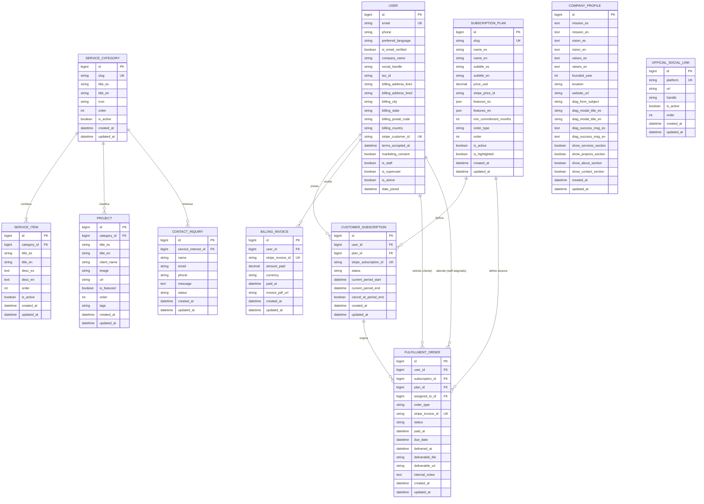
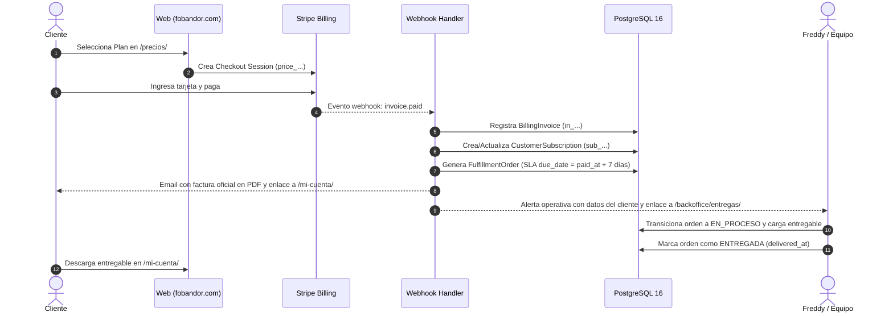
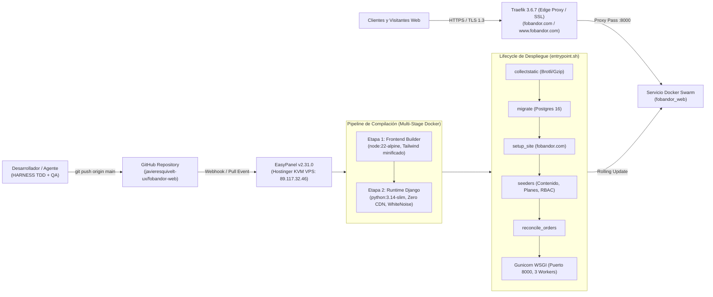

# SPEC.MD: Especificación Técnica y de Negocio — Plataforma FOBANDOR

## 1. Contexto de Negocio e Identidad de Marca
* **Emprendedor / Cliente:** Freddy Obando (Orlando, Florida, Estados Unidos).
* **Marca:** **FOBANDOR** (`www.fobandor.com`).
* **Audiencia Objetivo:** Comunidad latina y mercado general estadounidense (bilingüe Español / Inglés).
* **Slogans Oficiales:**
  * *"BUILD. ADVERTISE. ENTERTAIN. WITH AI."*
  * *"TU VISIÓN. NUESTRA TECNOLOGÍA. SIN LÍMITES."*
* **Valores de Marca:** Innovación, Creatividad, Resultados, Sin límites.
* **Canales Oficiales (Datos Reales para Seeding inicial y CMS):**
  * Sitio Web: `https://www.fobandor.com`
  * Instagram: `https://www.instagram.com/fobandor.ai` (`@fobandor.ai`)
  * TikTok: `https://www.tiktok.com/@fobandor` (`@fobandor`)
  * X (Twitter): `https://x.com/fobandor` (`@fobandor`)
  * YouTube: `https://www.youtube.com/@fobandor` (`fobandor`)
  * Facebook: `https://www.facebook.com/share/1EAAc7Qw6x/?mibextid=wwXIfr`

---

## 2. Sistema de Diseño y Lineamientos Visuales
* **Tipografía Primaria y Exclusiva:** `Montserrat` (pesos 400, 500, 600, 700, 800).
* **Paleta de Colores Corporativa (Tailwind CSS):**
  * Naranja Principal: `#FF6A00` (`fobandor-orange`)
  * Azul Principal: `#2563EB` (`fobandor-blue`)
  * Cian Acento: `#06B6D4` (`fobandor-cyan`)
  * Fondo Oscuro (Prioritario): `#0D1117` (`fobandor-dark`)
  * Fondo Claro: `#F3F4F6` (`fobandor-light`)
* **Isotipo y Favicons:** Generación de set estándar desde `instructions/logo-fobandor.jpg` (`favicon.ico`, `favicon-16x16.png`, `favicon-32x32.png`, `apple-touch-icon.png`, `site.webmanifest`).
* **Estética Visual:** Dark-tech futurista, acentos neón degradados (naranja/azul/cian), sombras sutiles y tarjetas translúcidas (*glassmorphism* controlado).

---

## 3. Catálogo de Servicios Inicial (4 Líneas de Negocio)
1. **Desarrollo Web con IA:** Sitios web corporativos, E-commerce, Landing pages, Chatbots y asistentes IA, Automatización de procesos.
2. **Desarrollo de Apps con IA:** Apps iOS / Android, Aplicaciones web, Apps con asistentes IA, Sistemas personalizados, Integración de APIs y automatizaciones.
3. **Publicidad con IA:** Campañas publicitarias, Videos para redes sociales, Creatividades con IA, Avatares y personajes, Copywriting y conceptos, Automatización de marketing.
4. **Fobandor Studios (Producción Audiovisual con IA):** Series, Películas, Podcasts, Trailers, Cortometrajes, Videoclips, Contenido para YouTube y redes.

---

## 4. Arquitectura de Software y Stack Tecnológico
* **Filosofía Arquitectural:** Arquitectura Limpia basada en *Django Styleguide* (Modelos delgados, vistas delgadas, lógica en `services.py`, consultas en `selectors.py`).
* **Backend:** Python 3.12+ (runtime de desarrollo: 3.14.4) con Django 5.2 LTS.
* **Modelo de Usuario:** `CustomUser` (`fobandor.users.models.User`) extendiendo `AbstractUser`, con correo electrónico como identificador principal (`USERNAME_FIELD = 'email'`).
* **Sistema de Autenticación e Identidad:**
  * **Autenticación Híbrida (Email + Contraseña y Cuentas Gmail):**
    * **Email + Contraseña Segura:** Hasheada con PBKDF2/Argon2 nativo de Django, con flujo de verificación previa por correo y reseteo bilingüe (ES/EN).
    * **Social Login con Cuentas Gmail (Google OAuth 2.0 / `django-allauth`):** Permite a los clientes registrarse o iniciar sesión con 1 solo clic. Las cuentas registradas con Gmail se marcan automáticamente con `is_email_verified = True` de forma instantánea al venir validadas por Google.
    * **Paso de Facturación AVS para Usuarios Gmail:** Al ingresar por primera vez con Gmail, el sistema redirige al usuario a completar sus datos de facturación (dirección completa y teléfono E.164) requeridos para el AVS de Stripe antes de habilitar el Checkout.
    * **Nota Arquitectónica sobre Google Workspace:** El soporte para inicio de sesión corporativo restringido a dominios Google Workspace (ej. `@fobandor.com`) queda documentado y contemplado en la arquitectura para una fase futura de expansión del staff, pero **excluido del plan de ejecución actual**.
* **Base de Datos:** PostgreSQL 16+ con soporte UTC en backend (`USE_TZ = True`) y conversión horaria a `America/New_York` para visualización administrativa en Orlando.
* **Frontend (100% Server-Driven, Cero Dependencia de CDNs Externos):**
  * **Estrategia "Zero External CDN":** Máxima resiliencia contra firewalls corporativos, bloqueadores de contenido y estricto cumplimiento de privacidad (GDPR). Todas las fuentes (Montserrat en formato WOFF2) y librerías JS (HTMX y Alpine.js) se alojan y sirven localmente desde `static/`.
  * **Motor de Plantillas:** Django Template Language (DTL) nativo modularizado en `partials/`.
  * **Reactividad HTTP:** **HTMX** local para navegación fluida y acciones dinámicas sin recargar la página completa.
  * **Micro-interactividad:** **Alpine.js** local (exclusivamente para estado visual efímero: tema Dark/Light persistente en `localStorage`, menús móviles y modales).
  * **Estilos:** **Tailwind CSS** compilado localmente con soporte `darkMode: 'class'` y paleta corporativa.
* **Pasarela de Pagos:** Stripe SDK:
  * Stripe Checkout en modo suscripción con soporte para cupones (`allow_promotion_codes=True`).
  * Stripe Customer Portal para cancelación y cambio de tarjeta con retorno canónico dinámico (`/es/mi-cuenta/`).
  * Webhooks firmados con verificación de firma criptográfica (`/stripe/webhook/`).
  * **Resiliencia Multi-Fuente & Modern Stripe API:** Compatibilidad completa con la estructura de precios moderna de Stripe (`pricing.price_details.price` y `price.id`), conversión segura de `StripeObject` a dict (`.to_dict()`), y mitigación de condiciones de carrera entre `invoice.paid` y `checkout.session.completed`.
* **Servicio de Correo Transaccional (Google Workspace SMTP):**
  * Integración SMTP sobre `smtp.gmail.com:587` con TLS y Contraseñas de Aplicación (`administrator@fobandor.com`).
  * Manejo defensivo en `CustomAccountAdapter` para evitar excepciones 500 ante desconexiones de socket.
  * Notificaciones de compra automáticas:
    * **Al Cliente:** Confirmación con enlace directo y oficial al PDF de la factura emitido por Stripe (`invoice_pdf`), enlace dinámico al portal de cliente (`/es/mi-cuenta/`) y soporte oficial (`admin@fobandor.com`).
    * **Al Equipo Interno (Staff + Grupo `Content_Editors`):** Alerta operativa inmediata con asunto estandarizado en hora de Florida (`America/New_York`): `Nueva compra de servicios - {fecha_hora_ny} - {cliente_email} - {servicio_y_plan}`, ficha de datos y enlace directo a `https://fobandor.com/en/backoffice/entregas/`.
    * **Formato "Menos es más" & Estilos Inline:** Diseño minimalista de alto contraste (`#ffffff` / `#0f172a`), estilos 100% inline en cada celda para compatibilidad universal con Gmail, Outlook y aplicaciones móviles.
* **Captura de Leads y Formularios de Diagnóstico (Formspree.io):**
  * **Procesamiento Asíncrono Serverless:** Los formularios de contacto y solicitud de diagnóstico comercial en la Landing (`/es/#contacto`) y en la página de Precios (`/es/precios/`) operan de forma asíncrona mediante Alpine.js (`@submit.prevent="submitForm($event)"` y Fetch API con cabecera `Accept: application/json`).
  * **Experiencia de Usuario In-App (Sin Redirecciones Externas):** Se evita por completo la redirección tradicional a la página externa de Formspree, respondiendo en el DOM con confirmación visual in-situ y mensajes bilingües configurables (`diag_success_msg_es` / `diag_success_msg_en` desde `CompanyProfile`).
  * **Anti-Spam y Trazabilidad:** Implementación de campo Honeypot invisible (`_gotcha`), asunto parametrizado dinámicamente (`_subject`) y despacho directo de notificaciones hacia la casilla de Freddy Obando (`for@fobandor.com`).
  * **Configuración 12-Factor:** Parametrizado mediante la variable `FORMSPREE_ENDPOINT` (`https://formspree.io/f/mqpqqggk` en producción) e inyectado en el contexto de vistas clave.
* **Seguridad y Cumplimiento:**
  * Estándar PCI-DSS: Cero almacenamiento de números de tarjeta, CVV o fechas de caducidad en la BD local. Todo reside en Stripe.
  * Verificación obligatoria de email (`is_email_verified=True`) antes de habilitar el botón de Checkout.
  * Registro de aceptación legal de Términos y Políticas con timestamp (`terms_accepted_at`).
* **Infraestructura y Contenedores (Docker / 12-Factor):** 
  * Principios 12-Factor vía `django-environ`, variables de entorno en `.env`.
  * **Paridad Dev/Prod con Docker:** PostgreSQL 16+ en contenedor Docker con volumen persistente para desarrollo y producción.
  * Preparado para despliegue en VPS (Hostinger u otro proveedor agnóstico) con Docker Compose, Gunicorn y Nginx.

---

## 5. Diagrama de Arquitectura de la Solución Completa (Docker & Clean Architecture)

```mermaid
flowchart TD
    %% =========================================================================
    %% CAPA 1: USUARIOS Y CLIENTES
    %% =========================================================================
    subgraph Actores["1. Actores y Dispositivos (Desktop / Tablet / Mobile)"]
        User_Public["Visitante Web (Mercado Latino & USA)\n[Navegación ES/EN, Dark/Light Mode]"]
        User_Client["Cliente Registrado y Verificado\n[Portal /mi-cuenta/, SLA Entregas, Billing]"]
        User_Staff["Equipo Interno FOBANDOR (RBAC)\n[Superadmin, Editor CMS, Operador Studio]"]
    end

    %% =========================================================================
    %% CAPA 2: EDGE, INGRESS Y ZERO-CDN ASSETS
    %% =========================================================================
    subgraph Edge["2. Ingress & Entrega Estática (Zero External CDN)"]
        Nginx["Nginx Reverse Proxy / SSL\n(Terminación TLS, Rate Limiting, Gzip)"]
        
        subgraph StaticAssets["Archivos Estáticos Locales (static/)"]
            FontsLocal["Montserrat WOFF2 Local\n(@font-face sin llamadas externas)"]
            JSLocal["HTMX 2.x & Alpine.js 3.x Locales\n(A prueba de bloqueos de red)"]
            CSSLocal["Tailwind CSS Compilado\n(Paleta FOBANDOR + dark:class)"]
            FaviconsLocal["Set de Favicons Oficiales\n(Generados desde logo-fobandor.jpg)"]
        end

        subgraph MediaAssets["Archivos Media (media/)"]
            MediaFiles["Imágenes CMS, Portafolios y\nEntregables Digitales (Pillow)"]
        end
    end

    %% =========================================================================
    %% CAPA 3: AMBIENTE DOCKERIZADO (DEV / PROD PARITY)
    %% =========================================================================
    subgraph DockerCompose["3. Ecosistema Docker (Paridad Dev / Prod)"]
        
        subgraph AppContainer["Contenedor Aplicación Web (Django 5.2 LTS / Python 3.12+ / Gunicorn)"]
            Core12Factor["Núcleo Django 12-Factor\n(django-environ, i18n ES/EN, Security)"]
            
            subgraph ModulosApp["Módulos de Aplicación (Thin Views / Models)"]
                App_Users["fobandor.users\nCustomUser, Gate Verificación Email, RBAC"]
                App_CMS["fobandor.cms\nServicios (4 Líneas), Proyectos, RRSS, Seeders"]
                App_Billing["fobandor.billing\nPlanes, Stripe Checkout, Webhooks, Portal"]
                App_Fulfillment["fobandor.fulfillment\nMotor SLA 7 Días (FulfillmentOrder)"]
                App_Core["fobandor.core\nHome Hero, Navegación, Switchers"]
            end

            subgraph CleanArch["Capa de Lógica de Negocio (Clean Architecture)"]
                Services["services.py\n(Mutaciones, API Stripe, Envíos de Correo)"]
                Selectors["selectors.py\n(Consultas y filtros optimizados ORM)"]
            end
        end

        subgraph DBContainer["Contenedor Base de Datos (PostgreSQL 16+)"]
            PostgreSQL[("PostgreSQL 16+ Engine\n(UTC Nativo + Vista America/New_York)")]
            DBVolume[("Volumen Persistente\npostgres_data")]
            PostgreSQL --- DBVolume
        end
    end

    %% =========================================================================
    %% CAPA 4: SERVICIOS EXTERNOS E INFRAESTRUCTURA VPS
    %% =========================================================================
    subgraph Externos["4. Ecosistema Externo e Infraestructura"]
        subgraph StripeServices["Stripe Payment Infrastructure"]
            StripeCheckout["Stripe Checkout (Suscripciones + Cupones)"]
            StripePortal["Stripe Customer Portal (Autogestión)"]
            StripeWebhook["Webhooks Firmados (checkout.session.completed, invoice.paid)"]
        end

        subgraph TransactionalMail["Email Transaccional (Google SMTP)"]
            MailActivation["Correo de Activación Obligatoria"]
            MailDelivery["Notificaciones de Compra y Alertas SLA"]
        end

        subgraph LeadCapture["Captura de Leads (Formspree)"]
            FormspreeAPI["Formspree.io Endpoint\n(Honeypot _gotcha, Notificación for@fobandor.com)"]
        end

        subgraph HostingVPS["Hosting Agnóstico (Producción)"]
            VPS["Hostinger VPS / Otro Proveedor VPS\n(Despliegue con Docker Compose / EasyPanel)"]
        end
    end

    %% =========================================================================
    %% CONEXIONES Y FLUJOS DE DATOS (SOLO NODO A NODO)
    %% =========================================================================
    User_Public -->|"HTTPS / HTMX"| Nginx
    User_Client -->|"HTTPS / HTMX"| Nginx
    User_Staff -->|"HTTPS / HTMX"| Nginx

    Nginx --> CSSLocal
    Nginx --> JSLocal
    Nginx --> FontsLocal
    Nginx --> FaviconsLocal
    Nginx --> MediaFiles
    Nginx --> Core12Factor

    Core12Factor --> App_Core
    Core12Factor --> App_Users
    Core12Factor --> App_CMS
    Core12Factor --> App_Billing
    Core12Factor --> App_Fulfillment

    App_Users --> Services
    App_CMS --> Selectors
    App_Billing --> Services
    App_Fulfillment --> Services

    Services -->|"Lectura / Escritura ORM"| PostgreSQL
    Selectors -->|"Consultas Optimizadas"| PostgreSQL
    PostgreSQL --- DBVolume

    Services -->|"Crear Sesión Checkout"| StripeCheckout
    Services -->|"Crear Sesión Billing Portal"| StripePortal
    StripeWebhook -->|"Eventos Firmados /stripe/webhook/"| App_Billing
    App_Billing -->|"Dispara Orden SLA 7 Días"| App_Fulfillment

    Services -->|"Envío Token Verificación"| MailActivation
    App_Fulfillment -->|"Aviso de Entrega Completada"| MailDelivery
    User_Public -->|"Solicitud Diagnóstico (AJAX Fetch)"| FormspreeAPI
    FormspreeAPI -->|"Alerta de Lead por Correo"| User_Staff

    Core12Factor -.->|"Despliegue Idéntico Docker"| VPS
```

---

## 6. Arquitectura de la Base de Datos Relacional y Diagrama Entidad-Relación (ERD)

La base de datos de FOBANDOR está implementada sobre **PostgreSQL 16+**, diseñada bajo principios de normalización (3FN), integridad referencial estricta, desacoplamiento transaccional y preparación nativa para análisis de datos y métricas comerciales (BI / Data Analytics).

### A. Principios Fundamentales del Diseño de Datos
1. **Separación de Dominios (Clean Architecture):** Los datos se estructuran en 4 dominios funcionales independientes:
   * **Identidad y Acceso (`fobandor.users`):** Cuentas de usuario, roles RBAC, verificación de identidad y perfil de facturación AVS.
   * **Gestión de Contenido Bilingüe (`fobandor.cms`):** Catálogo de líneas de servicio, casos de portafolio, redes oficiales y configuración singleton de empresa.
   * **Facturación Recurrente (`fobandor.billing`):** Planes comerciales, suscripciones activas y facturas inmutables sincronizadas con Stripe.
   * **Operación y Compromiso de Entrega (`fobandor.fulfillment`):** Motor de órdenes de servicio con semáforo SLA de 7 días, asignaciones y paquetes digitales.
2. **Seguridad y Cumplimiento PCI-DSS:** Cero almacenamiento de números de tarjeta bancaria, fechas de caducidad o códigos CVC en PostgreSQL. La base de datos local conserva exclusivamente punteros criptográficos opacos emitidos por Stripe (`stripe_customer_id`, `stripe_subscription_id`, `stripe_invoice_id`).
3. **Auditoría e Inmutabilidad Temporal:** Todas las entidades transaccionales registran marcas temporales `created_at` y `updated_at`. Los registros fiscales (`BillingInvoice`) y eventos de compromiso (`paid_at`, `due_date`, `delivered_at`) son persistidos de forma inmutable.
4. **Soporte Bilingüe Nativo (ES/EN):** Para el contenido editorial y catálogo de planes, se emplean pares de columnas explícitas (`_es` / `_en`), permitiendo consultas de alto rendimiento en un único `SELECT` sin overhead de librerías externas de traducción.

---

### B. Diagrama Entidad-Relación (ERD)

---

### C. Diccionario de Datos por Dominio

#### 1. Dominio de Identidad y Usuarios (`fobandor.users`)
* **Tabla `users_user` (Hereda de `AbstractUser` con `username = None`):**
  * `email` (VARCHAR 254, Unique, Not Null): Identificador primario de autenticación de clientes y staff.
  * `phone` (VARCHAR 16): Teléfono en formato internacional E.164 (`+14075551234`).
  * `is_email_verified` (BOOLEAN, Default False): Gate de seguridad; el usuario no puede pagar en Stripe si este campo es falso.
  * `company_name`, `social_handle`, `tax_id` (VARCHAR): Metadatos corporativos B2B opcionales para facturación de empresas.
  * `billing_address_line1`, `billing_city`, `billing_state`, `billing_postal_code`, `billing_country` (ISO-2): Datos de dirección para verificación AVS en Stripe.
  * `stripe_customer_id` (VARCHAR 100, Unique, Nullable): ID del cliente creado en Stripe (`cus_...`).
  * `terms_accepted_at` (TIMESTAMP WITH TIME ZONE, Nullable): Registro de cumplimiento legal de aceptación de políticas.
  * `is_staff` / `is_superuser`: Control de acceso por roles (RBAC) para acceso a `/backoffice/` y `/admin/`.

#### 2. Dominio de Facturación y Planes (`fobandor.billing`)
* **Tabla `billing_subscriptionplan` (Catálogo Comercial):**
  * `slug` (VARCHAR 60, Unique): Identificador URL (ej. `impulso`, `conversion`, `crecimiento`).
  * `name_es` / `name_en` (VARCHAR 120): Nombre comercial del plan.
  * `price_usd` (NUMERIC 8,2): Tarifa mensual oficial en dólares estadounidenses.
  * `stripe_price_id` (VARCHAR 100): ID del precio recurrente en Stripe (`price_...`). Permite a Freddy modificar tarifas en Stripe sin cambiar código.
  * `min_commitment_months` (SMALLINT, Default 1): Meses mínimos de compromiso (informativo para el cliente).
  * `order_type` (VARCHAR 20): Mapeo directo a la línea de entrega operativa (`WEB_DEV`, `APP_DEV`, `ADS_AI`, `STUDIOS`, `MARKETING`).
  * `is_highlighted` (BOOLEAN): Define cuál tarjeta se destaca con badge "RECOMENDADO" y color naranja en `/precios/`.
* **Tabla `billing_customersubscription` (Estado de Suscripciones en Stripe):**
  * `user_id` (FK ➔ `users_user`, CASCADE): Cliente titular de la suscripción.
  * `plan_id` (FK ➔ `billing_subscriptionplan`, SET_NULL): Plan contratado actualmente.
  * `stripe_subscription_id` (VARCHAR 100, Unique): ID de suscripción en Stripe (`sub_...`).
  * `status` (VARCHAR 20): Estado sincronizado por webhooks (`active`, `past_due`, `unpaid`, `trialing`, `canceled`).
  * `current_period_start` / `current_period_end` (TIMESTAMP): Ventana del ciclo de facturación mensual.
  * `cancel_at_period_end` (BOOLEAN): Indica si el cliente solicitó no renovar al término del periodo.
* **Tabla `billing_billinginvoice` (Registro Inmutable de Pagos):**
  * `user_id` (FK ➔ `users_user`, CASCADE): Cliente que realizó el pago.
  * `stripe_invoice_id` (VARCHAR 100, Unique): ID oficial de la factura en Stripe (`in_...`).
  * `amount_paid` (NUMERIC 10,2): Monto total pagado en USD.
  * `invoice_pdf_url` (URL): Enlace oficial al documento fiscal en PDF generado y firmado criptográficamente por Stripe.
  * `paid_at` (TIMESTAMP): Fecha y hora del pago exitoso.

#### 3. Dominio de Operaciones y Compromiso de Entrega (`fobandor.fulfillment`)
* **Tabla `fulfillment_fulfillmentorder` (Motor SLA a 7 Días):**
  * `user_id` (FK ➔ `users_user`, CASCADE): Cliente que recibe el servicio.
  * `subscription_id` (FK ➔ `billing_customersubscription`, SET_NULL, Nullable): Suscripción vinculada.
  * `plan_id` (FK ➔ `billing_subscriptionplan`, SET_NULL, Nullable): Plan contratado.
  * `assigned_to_id` (FK ➔ `users_user`, SET_NULL, Nullable): Responsable operativo interno (miembro de `Content_Editors`, `Fulfillment_Operators` o Administradores, default `for@fobandor.com`).
  * `stripe_invoice_id` (VARCHAR 100, Unique): Vinculación unívoca con la factura que disparó la orden.
  * `order_type` (VARCHAR 20): Tipo de orden (`WEB_DEV`, `APP_DEV`, `ADS_AI`, `STUDIOS`, `MARKETING`).
  * `status` (VARCHAR 25): Ciclo de vida (`PENDIENTE_PRODUCCION` ➔ `EN_PROCESO` ➔ `ENTREGADA` | `VENCIDA` | `CANCELADA`).
  * `paid_at` (TIMESTAMP): Inicio del compromiso del servicio.
  * `due_date` (TIMESTAMP): Fecha límite del SLA calculada automáticamente en BD (`paid_at + 7 días`).
  * `delivered_at` (TIMESTAMP, Nullable): Momento exacto en que el staff marca la entrega.
  * `deliverable_file` / `deliverable_url`: Archivo comprimido o enlace digital del resultado entregado al cliente en `/mi-cuenta/`.

#### 4. Dominio de Contenido y Diagnóstico (`fobandor.cms`)
* **`cms_servicecategory` y `cms_serviceitem`:** Catálogo jerárquico de las 4 líneas de negocio de FOBANDOR con ordenación y títulos bilingües.
* **`cms_project`:** Casos de éxito y portafolio con enlaces, imágenes, etiquetas y categorización.
* **`cms_companyprofile` (Singleton PK=1):** Registro único global con misión, visión, valores, metadatos y respuestas del formulario de diagnóstico de Formspree, y switches de visibilidad de secciones de la landing (`show_services_section`, `show_projects_section`, etc.).
* **`cms_contactinquiry`:** Registro de mensajes de prospectos recibidos desde la web.
* **`cms_officialsociallink`:** Enlaces y handles oficiales de redes sociales.

---

### D. Funcionamiento Operativo y Flujo del Dato en Producción

---

### E. Guía para Freddy y su Equipo: Potencial Analítico y Futuras Mejoras
Esta estructura relacional ha sido diseñada para permitir la incorporación inmediata de capas analíticas y de Business Intelligence (BI) sin requerir migraciones complejas ni rediseño:

1. **Métricas Clave de Negocio (SaaS KPIs) Calculables Directamente en SQL:**
   * **MRR (Monthly Recurring Revenue):** Suma de `price_usd` de los planes con `status = 'active'` en `CustomerSubscription`.
   * **ARR (Annual Recurring Revenue):** `MRR * 12`.
   * **Tasa de Churn (Cancelaciones):** Conteo de registros con `status = 'canceled'` o `cancel_at_period_end = True` agrupados por mes.
   * **LTV (Lifetime Value):** Suma histórica acumulada en `BillingInvoice.amount_paid` agrupada por `user_id`.
   * **Tasa de Cumplimiento de SLA:** Porcentaje de `FulfillmentOrder` donde `delivered_at <= due_date`.
   * **Tiempo Promedio de Entrega (Lead Time):** Promedio de `(delivered_at - paid_at)` por operador (`assigned_to`) y por línea de servicio (`order_type`).
2. **Conexión a Herramientas de BI y Dashboards:**
   * PostgreSQL puede conectarse mediante credenciales de solo lectura a herramientas como **Metabase**, **Apache Superset** o **Looker Studio** para generar paneles ejecutivos en tiempo real para Freddy Obando.
3. **Escalabilidad Analítica Futura (Data Warehouse / BigQuery):**
   * Gracias a la integridad de claves y timestamps, las tablas `billing_billinginvoice`, `fulfillment_fulfillmentorder` y `users_user` pueden sincronizarse directamente mediante pipelines ELT (conforme a la skill `etl-pipelines` y `data-engineering`) hacia un almacén analítico como Google BigQuery o un Data Mart dimensional con tablas de Hechos (*Fact Sales*, *Fact SLA Delivery*) y Dimensiones (*Dim Client*, *Dim Plan*, *Dim Time*).

---

## 7. Hoja de Ruta de Construcción y Estado de Ejecución (Macro Etapas)
* **Etapa 1:** Cimientos, Branding y UI Base en `localhost` (Django 5.2 LTS, PostgreSQL, Tailwind, Montserrat, Favicons, i18n ES/EN, Dark/Light Mode). ✅
* **Etapa 2:** Identidad, RBAC y Backoffice CMS (`CustomUser`, Seeding inicial de 4 líneas y RRSS, panel administrativo `/backoffice/`). ✅
* **Etapa 3:** Registro de Clientes y Autenticación Híbrida (Email/Password + Social Login con cuentas Gmail y Google Workspace vía Google OAuth 2.0), Formulario de Onboarding AVS para Stripe, Stripe Checkout (3 planes + cupones), Webhooks firmados, SLA de 7 días (`FulfillmentOrder`) y Portal del Cliente (`/mi-cuenta/`). ✅
* **Etapa 4:** SEO Técnico, Optimización de Rendimiento, Suite de Pruebas `pytest`, Auditoría OWASP, Empaquetado Docker y Despliegue en VPS Hostinger con EasyPanel y Traefik. ✅
* **Etapa 5:** Refinamiento Integral de UX y CMS (Puntos 1 al 11: Misión/Visión/Valores dinámicos en Landing desde `CompanyProfile`, Selector de Idioma `/i18n/setlang/`, Enlaces Canónicos, Diagnóstico Formspree en Contacto, Switches de Secciones, Blindaje Móvil de Navbar y Retorno al Portal de Cliente). ✅
* **Etapa 6:** Depuración de Hallazgos QA y Embudo Allauth (Contraste universal en inputs en `static/css/input.css`, selector interactivo de planes en `/precios/` con Alpine.js y maquetación corporativa del embudo de autenticación). ✅
* **Etapa 7:** Integración de Google Workspace SMTP (`smtp.gmail.com:587` TLS) con contraseñas de aplicación para verificación obligatoria de correo y reseteo de contraseñas con manejo defensivo de red. ✅
* **Etapa 8:** Resiliencia Multi-Fuente en Webhooks Stripe y Corrección de Órdenes SLA (Resolución de carrera entre `invoice.paid` y `checkout.session.completed`, backfill bidireccional y comando `reconcile_fulfillment_orders`). ✅
* **Etapa 9:** Notificaciones Transaccionales de Compra por Correo (Despacho automático de factura Stripe en PDF al cliente y alerta interna dinámica con asunto en hora de Florida para Staff + grupo `Content_Editors`). ✅
* **Etapa 10:** Blindaje de Webhooks Stripe ante API Moderna (Soporte jerárquico de precios `pricing.price_details.price` y compatibilidad con `StripeObject`, inyección SMTP en Docker Swarm VPS y reconciliación E2E). ✅
* **Etapa 11:** Optimización UX de Notificaciones por Correo (Rediseño minimalista de alerta interna con estilos 100% inline para compatibilidad universal con Gmail, enlace canónico dinámico `reverse("portal:dashboard")` apuntando a `/es/mi-cuenta/` y simplificación sobria de firmas "menos es más"). ✅

---

## 8. Metodología de Integración y Despliegue Continuo (CI/CD: GitHub ➔ Hostinger VPS)

### A. Filosofía de Entrega Continua (Trunk-Based)
* **Rama Principal Única (`main`):** El repositorio en GitHub (`https://github.com/javieresquivelt-ux/fobandor-web`) opera bajo trunk-based development. Todo código integrado en `main` debe superar previamente en local la suite de pruebas unitarias/integración (`pytest`), linter (`flake8`) y compilación CSS libre de errores.
* **Control de Versiones y Releases:** Las versiones estables mayores se etiquetan mediante Git Tags semánticos (e.g., `v1.0.0`), permitiendo auditoría y trazabilidad del historial de despliegues.

### B. Pipeline de Compilación Multi-Etapa (`Dockerfile`)
Para optimizar el tamaño de la imagen, maximizar la seguridad OWASP y eliminar dependencias de compilación en el servidor productivo, se implementa un `Dockerfile` en dos etapas:
1. **Etapa 1 — `frontend-builder` (`node:22-alpine`):**
   * Descarga determinista de paquetes Node con `npm ci`.
   * Compilación, purga y minificación de estilos Tailwind CSS hacia `static/css/output.css`.
   * La totalidad de `node_modules` y herramientas Node son excluidas del runtime final.
2. **Etapa 2 — `runner` (`python:3.14-slim`):**
   * Runtime oficial liviano basado en Debian Slim con dependencias mínimas de sistema (`curl`).
   * Instalación estricta de dependencias Python de producción (`requirements/base.txt`) con `--no-cache-dir`.
   * Copia del CSS compilado y artefactos estáticos.
   * Ejecución bajo usuario de sistema sin privilegios `django:django` (UID 1000) bajo el principio de menor privilegio.

### C. Ciclo de Vida de Despliegue y Auto-Provisionamiento (`entrypoint.sh`)
Cada ciclo de despliegue en el Hostinger VPS ejecuta de forma determinista y transaccional:
1. `collectstatic --noinput`: WhiteNoise genera el manifiesto de nombres hasheados inmutables (`CompressedManifestStaticFilesStorage`) y pre-comprime estáticos en Brotli y Gzip.
2. `migrate --noinput`: Ejecución segura de migraciones pendientes en PostgreSQL 16.
3. `setup_production_site`: Configura de manera idempotente el Site oficial `www.fobandor.com` en `django.contrib.sites`.
4. `seed_initial_content` & `seed_subscription_plans`: Mantiene sincronizado el catálogo de las 4 líneas de servicio, proyectos, misión/visión y los 3 planes de suscripción con Stripe.
5. `create_rbac_groups`: Asegura la existencia y permisos de los grupos `Content_Editors` y `Fulfillment_Operators`.
6. `reconcile_fulfillment_orders`: Reconcilia de manera defensiva órdenes de entrega SLA huérfanas derivadas de compras completadas.
7. `createsuperuser --noinput`: Auto-creación del superusuario administrativo inicial si se detectan variables de entorno.
8. `exec gunicorn`: Lanzamiento del servidor WSGI en el puerto `8000` con 3 workers asíncronos y timeout de 120s.

### D. Orquestación en Hostinger VPS (EasyPanel & Docker Swarm)
* **Infraestructura:** Servidor Hostinger KVM VPS (`89.117.32.46`, Ubuntu Linux x86_64, 8 GB RAM, 96 GB NVMe SSD) gestionado por EasyPanel v2.31.0 sobre Docker Swarm.
* **Rolling Updates con Cero Downtime:** EasyPanel despliega el nuevo contenedor, aguarda la confirmación de salud operativa (`healthcheck`) y conmuta el tráfico en vivo antes de retirar el contenedor antiguo.
* **Persistencia de Volúmenes:**
  * `fobandor_media`: Volumen persistente montado en `/app/media/` para la preservación íntegra de paquetes digitales de entrega y multimedia cargada por administradores.
  * Base de datos PostgreSQL 16 administrada internamente por EasyPanel en red overlay aislada.
* **Terminación SSL y Edge Routing (Traefik 3.6.7):**
  * Traefik escucha en puertos 80 y 443, gestionando automáticamente la emisión y renovación de certificados TLS mediante Let's Encrypt para `fobandor.com` y `www.fobandor.com`.
  * Redirección forzada HTTP ➔ HTTPS y cabeceras de proxy inverso seguras (`X-Forwarded-Proto`, `X-Forwarded-Host`, `X-Forwarded-Port`).
* **Gobernanza 12-Factor de Secretos:** Configuración inyectada de variables de entorno seguras en tiempo de ejecución (Stripe keys, Google Workspace OAuth & SMTP, PostgreSQL y Formspree).

